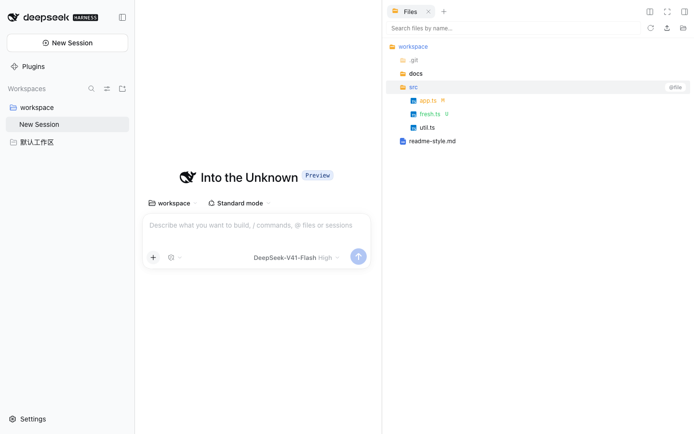
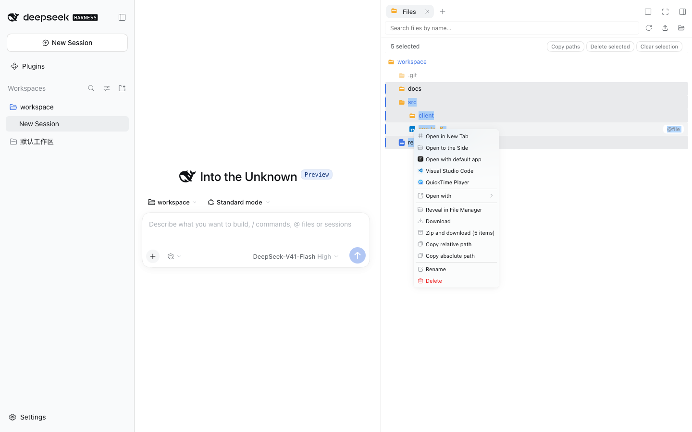
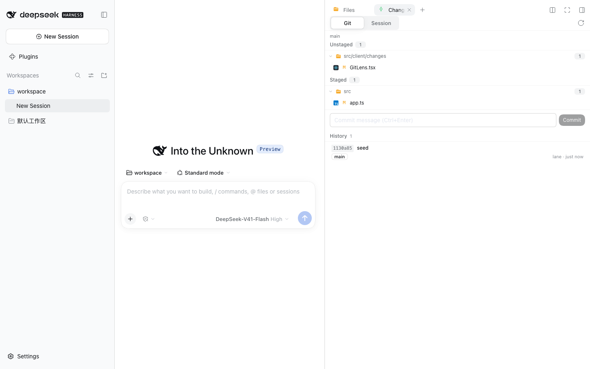

# dsh-better-sidebar

<div align="center">
  <b style="font-size: 1.15em;">A dual workbench for DSH: native right sidebar + self-drawn bottom panel, with the <code>ctx.betterSidebar</code> service open to every plugin</b><br /><br />
  <a href="https://www.npmjs.com/package/dsh-better-sidebar"></a>
  <a href="https://www.npmjs.com/package/dsh-better-sidebar"></a>
  <a href="https://github.com/omdsh-dev/DSH-better-sidebar/actions/workflows/ci.yml"></a>
  <a href="https://github.com/omdsh-dev/DSH-better-sidebar/stargazers"></a>
  <a href="https://opensource.org/licenses/MIT"></a>
  <a href="https://www.npmjs.com/package/@deepseek-ai/dsh?activeTab=versions"></a>
</div>

<div align="center">
  🌏 <a href="./README_ZH.md">中文</a> · <a href="./README.md"><b>English</b></a>
</div>

<div align="center">
  <video src="https://github.com/user-attachments/assets/23187822-047e-45cc-b480-fe997bd55b86" muted autoplay loop playsinline controls width="100%"></video>
</div>

## ✨ Features

| | |
|---|---|
| **🗂️ File Management**<br/>Lazy-loading tree, git status colors, live directory watch, global search, drag-and-drop upload, multi-select batch actions, dual-source "Open with" menu.<br/><br/> | **🌿 Git**<br/>Source Control (Merge / Staged / Changes groups, message box with Generate, branch + sync footer) plus a this-session AI-changes lens, with a **read-only commit graph** (lanes, ref badges, branch filter, commit details) in one tab.<br/> |
| **📝 Editable Editor & Previews**<br/>An editable CodeMirror (the stock preview is read-only), Markdown + Mermaid + floating outline, sandboxed HTML preview, `.jsonl` record cards, paged preview for huge files, streaming transfers with no size caps.<br/> | **🧩 Tasks**<br/>Live subagent topology (workflow graph / tree modes) + background task list: exit codes, live output, force-kill.<br/> |
| **💬 Side Chat (beta)**<br/>Codex-style side threads: inherit the full parent context and run independently, realtime push, visible & revocable queue, per-thread model selection, one-click promotion to a top-level session.<br/> | **🖥️ Bottom Workbench**<br/>A self-drawn bottom panel that coexists with the native right sidebar: drag-to-split panes, multiple terminal tabs, per-session persisted layout.<br/> |

**Also**: 📂 the `sidebar_open` tool lets the model open the sidebar itself · ⚡ ~325KB core at startup, heavy chunks load on demand · 🌏 i18n follows DSH · 📱 narrow screens switch to a full-width drawer

### 🌿 Git Graph (read-only commit graph)

Switch to **Git Graph** at the top of the Git panel for commit nodes, forks and merge edges across local branches, remote-tracking branches and HEAD. The branch selector only filters history — it **never checks out or fetches**; each commit is one line (lane edges + ref pills + subject), hover shows the author and short hash, and selecting one opens its full message and diff in the bottom pane. History loads in pages; reference changes during pagination prompt a refresh; reads are bounded (200 commits per page, offset 10,000, 1,000 branches) and report an explicit error past a limit. This first version shows no tags and offers no history-changing actions.

### 🧭 dsh-context diagnostics (optional)

With the `dsh-context` plugin installed, three places offer a one-click jump into that conversation's **Context** view: an agent node's detail card on the Tasks page, a background job's output window (the job's real owner session — never merely the session its row was watched under), and the session header. The entries **appear only** while dsh-context's `Context` page is actually registered: a deployment without it (or with that page hidden) shows no control at all, and while one jump is in flight every entry point is disabled. A failed jump is reported once, in a dismissible alert at the frame's bottom edge; nothing is polled while idle.

## 🚀 Installation

```sh
dsh plugin --profile web add dsh-better-sidebar@latest
```

Then **hard-refresh the browser** (Cmd/Ctrl+Shift+R). Requires DSH **0.2.1-rc.1+**.

> **Compatibility warning — v0.28.0 will take over this plugin's npm `latest`.** DSH's own npm `latest` still points to **0.2.0-rc.2**, which is **not compatible** with v0.28.0. On that host, pin `dsh-better-sidebar@0.26.1` instead of using the command above. DSH 0.2.1-alpha.5 users must pin `dsh-better-sidebar@0.28.0-alpha.0`. Upgrade the host explicitly to `0.2.1-rc.1` before installing v0.28.0; the two packages' `latest` tags are independent.

<details>
<summary><b>Pick the plugin version for your DSH version</b></summary>

| Your DSH version | Install command |
| --- | --- |
| **0.2.1-rc.1+** | `dsh plugin --profile web add dsh-better-sidebar@0.28.0` |
| **0.2.1-alpha.5** | `dsh plugin --profile web add dsh-better-sidebar@0.28.0-alpha.0` |
| **0.2.0-rc.2** | `dsh plugin --profile web add dsh-better-sidebar@0.26.1` |
| **0.2.0-rc.1** | `dsh plugin --profile web add dsh-better-sidebar@0.24.1` |
| **0.1.7-rc.1 ~ 0.1.7 stable** | `dsh plugin --profile web add dsh-better-sidebar@0.22.1` |
| 0.1.7-alpha.x | No compatible release — upgrade DSH to rc.1 first |
| 0.1.6 and earlier (incl. the 0.1.5 line) | `dsh plugin --profile web add dsh-better-sidebar@0.19.1` |

Always pin **exact versions** for older releases (`latest` moves forward with each new stable). Replace `web` with your own profile name.

</details>

<details>
<summary><b>Other ways to install</b></summary>

**Let DSH install it for you** — paste this prompt into any DSH session:

```text
Install the dsh-better-sidebar plugin (a sidebar workbench for DSH):
1. Confirm DSH is 0.2.1-rc.1 or newer, then run dsh plugin --profile web add dsh-better-sidebar@0.28.0
2. Remind me to hard-refresh the browser (Cmd/Ctrl+Shift+R) afterwards
If something fails, check the FAQ table in https://github.com/omdsh-dev/DSH-better-sidebar README first.
```

**One-line script** — clone this repo and run `bash scripts/install.sh 0.28.0` (macOS / Linux / Windows Git Bash; `./scripts/install.ps1 -Version 0.28.0` for native Windows). It handles installation + bundle registration.

**Updating**: just re-run the install command, then hard-refresh the browser.

</details>

<details>
<summary><b>FAQ</b></summary>

| Symptom | Cause & fix |
|---|---|
| `Ignored build scripts` error | pnpm 11 blocked a transitive dependency's build script. Run `pnpm approve-builds` in the profile directory (`~/.dsh/profiles/web`) — this plugin itself has no build-script dependencies. |
| `minimum release age` / version younger than 24h | The release is less than 24 hours old. Wait 24h or re-run (pnpm auto-adds `minimumReleaseAgeExclude`). |
| "Profile directory not found" | Run `dsh web` once to initialize `~/.dsh/profiles/web`. |
| **Two sidebars** on the page | Double mounting. Remove the legacy manual mount line (`- insert: ... better-sidebar ...`) from `~/.dsh/profiles/web/cordis.patch.yml`; aggregate packages mounting this package under a different id are auto-yielded, no action needed. |
| Settings values gone after upgrade | Since DSH 0.1.7, preferences live on this plugin's mount row in the profile (default entry id `better-sidebar`). The plugin migrates your old `settings.yaml` values once on first start and never overwrites newer values. |
| Terminal unavailable | Terminals are provided by **DSH itself** (this plugin ships no PTY) — see DSH docs; "host provides no terminal capability" in the bottom terminal means this deployment has no terminal controller mounted. |
| `dsh: command not found` | Install DSH first; or use `npx -y --package @deepseek-ai/dsh@0.2.1-rc.1 dsh plugin --profile web add dsh-better-sidebar@0.28.0`. |

</details>

## 🆕 Recent Updates

**v0.28.0 — stable plugin release for DSH 0.2.1-rc.1+**

- Move all 13 DSH peer floors to `^0.2.1-rc.1`; retain the alpha.0 functionality without runtime changes
- The upstream alpha.5 → rc.1 full-tree diff contains 355 files, all `package.json`; no source changes
- v0.28.0 will replace this plugin’s npm `latest`, even while DSH’s `latest` remains 0.2.0-rc.2; old hosts must pin the versions in the table above
- RC validation is pending; see the [RC adaptation record](./docs/plans/2026-10-17-dsh-0.2.1-rc.1-adaptation.md). Earlier alpha test counts are not RC evidence

**v0.28.0-alpha.0 (prerelease)**

- Adapt to DSH **0.2.1-alpha.5+**: use native Connection admission for HTTP/WS and remove the retired invariant companion and dependency
- Files, Git, terminals and newly created side chats follow the session’s current working directory
- The commit graph fills the available Git-panel height and adapts to the diff preview and window size
- Optional dsh-context diagnostic shortcuts in agent details, background-job output windows and the session header appear only when the Context entry is available
- **DSH 0.2.0-rc.2 users stay on npm-published v0.26.1**; v0.27.0 has not been published. Use the explicit alpha version above, not `latest`
- Validation history: [DSH alpha.5 adaptation record](./docs/plans/2026-10-16-dsh-0.2.1-alpha.5-adaptation.md) (before the latest dev integration; not the final release test counts)

**v0.27.0** - full release history at [Releases](https://github.com/omdsh-dev/DSH-better-sidebar/releases) · [CHANGELOG](./CHANGELOG_EN.md)

- **Git page rebuilt**: Source Control groups, a read-only commit graph with branch filtering, and a shared Commit details / Content / Diff pane
- **Accurate change tracking**: separate staged/unstaged counts, nested-repository discovery, session-relative paths, PTC file operations and long polling
- **Selection stays in place**: fixed the integration regression that displaced selected files and drew stray borders; added real-host layout coverage
- **Side Chat**: new child sessions seed from the latest summarizing compaction instead of copying the full parent log

**v0.26.1** — full release history at [Releases](https://github.com/omdsh-dev/DSH-better-sidebar/releases) · [CHANGELOG](./CHANGELOG_EN.md)

- ⚡ **Fixed the steady-state cost behind "fine on 0.24, then it got slow"** (community reports: the sidebar turns laggy after being open a long time, DSH turns laggy after many turns, a restart clears it for a while; an artifact-level A/B puts the line at v0.25.0): both 500 ms timers are now visibility-gated (the host right-panel state is one shared module-level poller; the blank-session fallback only runs while it actually renders), the per-tab 5 s session-root poll became **one per session and only while visible**, the file-tree watch and side-chat push stop when parked, `keepMounted` keeps its semantics while every cache/registry is now bounded, and the host cwd resolver gained in-flight dedupe with a 3 s → 15 s TTL
- 📊 Measured in the real mount lane (4 visited tabs, 15 s idle window): live 500 ms timers **3 → 1**, live 5 s timers **5 → 0**, `session.cwd` requests **15 → 0**, hit tests **1,620 → 0**, forced layouts **5,190 → 30**

## 🔌 Plugin Ecosystem

`ctx.betterSidebar` offers two extension points to every plugin — `registerTab` / `registerFileViewer`; the built-in 6 tabs + 4 viewers use the very same API. The GitHub topic [`dsh-better-sidebar`](https://github.com/topics/dsh-better-sidebar) already lists **30+ ecosystem plugins**; the full integration guide is at **[docs/external-plugin-guide.md](./docs/external-plugin-guide.md)**.

```ts
import type {} from 'dsh-better-sidebar'  // triggers the ctx.betterSidebar type merge
export const inject = ['betterSidebar']
export function apply(ctx: Context) {
  ctx.effect(() => ctx.betterSidebar.registerTab({
    id: 'my-plugin:db', title: 'Database', component: ({ scope }) => <DbView sessionId={scope.sessionId} />,
  }))
}
```

<details>
<summary><b>Ecosystem catalog (28 tab plugins · 4 viewer plugins · 4 enhancements)</b></summary>

### 📑 Tab plugins (sidebar pages)

| Plugin | ⭐ | Description |
|---|---|---|
| [ChenRuoT/dsh-sidebar-qa](https://github.com/ChenRuoT/dsh-sidebar-qa) |  | Select-to-ask side page: Codex-style side questions / Claude Code `/btw` |
| [fuhefei/dsh-sentinel](https://github.com/fuhefei/dsh-sentinel) |  | Condition-driven wake-up system: file / command / HTTP / process / webhook watchers that wake an agent; dock + sidebar branch + global dashboard |
| [Fisfzy/ego-browser](https://github.com/Fisfzy/ego-browser) |  | Agent browser: i18n-aware local browser tab (auto-registers a sidebar page when better-sidebar is present, falls back to a floating observer) |
| [jiuge2467/dsh-studio](https://github.com/jiuge2467/dsh-studio) |  | Full-stack workbench: multi-source MCP visual debugging hub, visual thinking engine |
| [Iwctwbh/dsh-flowglass](https://github.com/Iwctwbh/dsh-flowglass) |  | Flowglass: realtime session flow visualization (messages / tool groups / subagent branches) |
| [FeatherHunter/dsh-mattpocock-skills-deck](https://github.com/FeatherHunter/dsh-mattpocock-skills-deck) |  | Gamified mattpocock/skills task system: fog-of-war map, task bar progression |
| [GULI-lab/DSH-element-source](https://github.com/GULI-lab/DSH-element-source) |  | Click any UI element to jump to its Vue / React / Svelte / Angular source and feed it into the session |
| [Lzh3070/dsh-file-review-tab](https://github.com/Lzh3070/dsh-file-review-tab) |  | File review page: line-level red/green diff + undo + deep links into chat lines |
| [yq04/dsh-git-remotes](https://github.com/yq04/dsh-git-remotes) |  | Git remotes page: branches / upstreams / ahead-behind, fetch with prune, ff-only pull, confirmed push |
| [ztyhehe/dsh-better-sidebar-svn](https://github.com/ztyhehe/dsh-better-sidebar-svn) |  | SVN source-control page: status / diff / log / commit / update / revert / conflict resolution, symmetric to the built-in Git panel |
| [Melody-max114/dsh-excel-panel](https://github.com/Melody-max114/dsh-excel-panel) |  | Excel editing page: xlsx preview / edit, live formula evaluation, merged cells, save back to the original file |
| [v587d/dsh-anysearch-refs](https://github.com/v587d/dsh-anysearch-refs) |  | AnySearch result reference cards: query, source digest, keyword highlights |
| [Lukeknow0/dsh-markdown-link-preview](https://github.com/Lukeknow0/dsh-markdown-link-preview) |  | Markdown artifact link preview: click same-origin `.md` outputs in chat to read them in the sidebar |
| [mlosun/dsh-docs-panel](https://github.com/mlosun/dsh-docs-panel) |  | Global docs panel: portable Markdown notes readable from any workspace |
| [tylina/dsh-tylina](https://github.com/tylina/dsh-tylina) |  | Typst document tool: WYSIWYG typesetting for papers, reports, exams, resumes, charts, posters, sheet music, and PPTX-exported slides |
| [lnyuqian/dsh-skill-sidebar](https://github.com/lnyuqian/dsh-skill-sidebar) |  | Skills panel: scans local skill directories, short action phrases + one-click copy + pinning |
| [g-yixuan/dsh-sidenote](https://github.com/g-yixuan/dsh-sidenote) |  | Codex-style side chat + selection-anchored annotations (lightweight consumer plugin) |
| [OMSociety/dsh-ssh-tunnel](https://github.com/OMSociety/dsh-ssh-tunnel) |  | Multi-host SSH tunnels + SSH manager page |
| [OMSociety/dsh-git-forge](https://github.com/OMSociety/dsh-git-forge) |  | GitHub / Gitea accounts, project authorization and push policies |
| [YesSanSan/dsh-conversation-outline](https://github.com/YesSanSan/dsh-conversation-outline) |  | Conversation outline page: turn-structured view, one-click jump, LLM one-line titles |
| [Wulabalabo/dsh-sidebar-Explorer-Plus](https://github.com/Wulabalabo/dsh-sidebar-Explorer-Plus) |  | File manager page: upload / move / delete / rename / new folder (write operations) |
| [yq04/dsh-turn-review](https://github.com/yq04/dsh-turn-review) |  | Turn review: review agent changes turn by turn |
| [Ghz114514/dsh-refpics](https://github.com/Ghz114514/dsh-refpics) |  | Pinterest-style reference-image search: masonry flow, sidebar board, download & Eagle favorites |
| [yzlin499/dsh-yzlin499-easy-plugins](https://github.com/yzlin499/dsh-yzlin499-easy-plugins) |  | Handy utility bundle (friendly to bare-bones DSH) |
| [dong-victor/dsh-better-sidebar-starter](https://github.com/dong-victor/dsh-better-sidebar-starter) |  | Run-configuration page: IDEA-style Run/Debug configs — one-click start, history, WebSocket live logs, parallel instances |
| [baosfeng/my-dsh-plugins](https://github.com/baosfeng/my-dsh-plugins) |  | Personal plugin collection (`dsh-file-activity`): sidebar file-activity page — read / create / modify history and stats |
| [Hoemr/dsh-better-overleaf](https://github.com/Hoemr/dsh-better-overleaf) |  | Overleaf tab: CDP browser login, project switching, local git mirror with two-way sync |
| [Andor-Z/dsh-turn-outline](https://github.com/Andor-Z/dsh-turn-outline) |  | Turn-trace page: folds the session by user turns, click any step to jump back to its chat position; zero LLM, read-only |

### 🖼️ Viewer plugins (file viewers)

| Plugin | ⭐ | Description |
|---|---|---|
| [HuanLinOTO/dsh-plugin-better-sidebar-plugin-office](https://github.com/HuanLinOTO/dsh-plugin-better-sidebar-plugin-office) |  | Office trio preview (.docx / .xlsx / .pptx), shipped as a separate slim bundle |
| [HuanLinOTO/dsh-plugin-better-sidebar-plugin-audio](https://github.com/HuanLinOTO/dsh-plugin-better-sidebar-plugin-audio) |  | Audio preview: zoomable waveform player + realtime spectrum, HTTP Range streaming route, scrubbable at any size |
| [zemul/dsh-video-preview](https://github.com/zemul/dsh-video-preview) |  | Inline video preview: .mp4 / .webm / .mov / .mkv / .avi with HTTP Range seeking |
| [dong-victor/dsh-better-sidebar-jupyter](https://github.com/dong-victor/dsh-better-sidebar-jupyter) |  | Runnable `.ipynb` notebook view: lazy Python kernel, streaming output, save-back |

### 🧰 Enhancements & tools

| Plugin | ⭐ | Description |
|---|---|---|
| [eg-bole/dsh-better-sidebar-icons](https://github.com/eg-bole/dsh-better-sidebar-icons) |  | VSCode-style file / folder icon theme (vscode-icons port, pure DOM overlay, zero intrusion) |
| [dong-victor/dsh-better-sidebar-terminal-plus](https://github.com/dong-victor/dsh-better-sidebar-terminal-plus) |  | Terminal enhancements: bundled Nerd Font icons, fixed xterm icon rendering, stable terminal cwd |
| [Max-Null/dsh-sidebar-preview-select](https://github.com/Max-Null/dsh-sidebar-preview-select) |  | Preview selection boost: select text in the sidebar preview → floating "send to session" |
| [Hoemr/dsh-quicklook](https://github.com/Hoemr/dsh-quicklook) |  | QuickLook-style Space preview: press Space on the active file tab for full-size image / PDF / text |

</details>

> 📣 **List your plugin**: tag your repo with the `dsh-better-sidebar` topic to appear on the [topic page](https://github.com/topics/dsh-better-sidebar); then PR a `PluginEntry` into [`src/client/plugins-tabs.ts`](./src/client/plugins-tabs.ts) / [`plugins-viewers.ts`](./src/client/plugins-viewers.ts) to join the in-app recommended catalog.

<details>
<summary><b>⌨️ Keyboard Shortcuts</b></summary>

| Action | Keys |
|---|---|
| Save editor | `Ctrl/Cmd + S` |
| Find / replace in file | `Ctrl/Cmd + F` |
| Find next / previous | `Ctrl/Cmd + G` / `Shift + Ctrl/Cmd + G` |
| Select next occurrence | `Ctrl/Cmd + D` |
| Git commit | `Ctrl + Enter` |
| Close tab | Middle-click |
| Split / merge panes | Drag a tab to a pane edge / center |
| Reference a file in the input box | Hover a row → `@file` button |

</details>

<details>
<summary><b>🔐 Security & ⚠️ Known Limitations</b></summary>

- Routes sit behind a Host-header trust fence (same as `/api`); `fs.write` is atomic; git is only invoked via CLI and never sets identity
- ⚠️ **Since v0.23.0 the fs routes do no workspace-containment check**: they can read/write any path the host user can reach (OS permissions only) — callers must not treat these routes as fenced
- HTML previews render in an **opaque-origin sandboxed iframe**; the sandbox can be disabled per feature in settings (off by default, with warnings)
- No git push/pull/fetch; the file tree only watches **expanded** directories; Markdown preview renders the saved file
- Read-only formats (spreadsheets / PDF / images / Office) are rendered by DSH's own document preview and follow the host version; the browser view only exists in the desktop profile
- Unsaved drafts are confirmed before closing a tab / deleting a file / refreshing; saving after external modification is rejected, never silently overwritten
- On mobile (<768px) there is no bottom panel — its tabs merge into the right sidebar's full-width drawer

</details>

<details>
<summary><b>🛠️ Development & Build</b></summary>

```sh
pnpm install      # @deepseek-ai/* devDependencies are published, resolves directly
pnpm typecheck && pnpm lint && pnpm build && pnpm test
make check        # aggregate gate (matches CI)
make mount        # real-mount smoke: build + pack → pnpm test:mount
```

**Architecture**: a single npm package with host/client halves — host (`src/index.ts`): `/sidebar/api/*` JSON API, media / HTML preview / upload routes and two WebSockets; client (`src/client/index.tsx`): native right-sidebar tabs + bottom workbench; state persisted per session in localStorage. Repository rules: [`AGENTS.md`](./AGENTS.md).

Windows / Linux / macOS supported (macOS verified daily, the rest covered by unit tests and Windows CI); no native dependencies — building needs only Node ≥ 20 + pnpm ≥ 10.

</details>

## 💬 Community

QQ group: 577011007

<div align="center">
  
  
</div>

## 🤝 Contributing

- **Code changes go through PRs**: develop on a `feat/*` / `fix/*` branch → `gh pr create`; run `pnpm typecheck && pnpm build && pnpm test` (or `make check`) before submitting
- **List an ecosystem plugin**: tag your repo with `dsh-better-sidebar` + PR an entry into [`src/client/plugins-tabs.ts`](./src/client/plugins-tabs.ts) / [`plugins-viewers.ts`](./src/client/plugins-viewers.ts)
- Repository rules: [`AGENTS.md`](./AGENTS.md)

## 👥 Contributors

<a href="https://github.com/omdsh-dev/DSH-better-sidebar/graphs/contributors">
  
</a>

## 🔗 Friends

- [dsh-tianshu-tui](https://github.com/huiliyi37/dsh-tianshu-tui): interactive terminal UI plugin for DeepSeek Harness with TDD and evidence-gate workflows
- [dsh-TUI](https://github.com/ccch1mneyyy/dsh-TUI): Claude Code-style fullscreen terminal plugin — pixel-whale header, streaming thoughts, context progress bar + TPS gauge
- [dshfind plugin store](https://dshfind.com/zh/plugins): third-party plugin market — public repos under the `dsh-plugin` topic, synced daily
- [DeepSeek Harness Desktop Tauri](https://github.com/hairyf/deepseek-harness-desktop): Tauri desktop build — 5MB installer, zero setup, plugins preinstalled
- [DeepSeek Harness Desktop](https://github.com/anywhere-labs/deepseek-harness-desktop): a modern desktop app — start and manage local Harness services without configuring Node.js; [website](https://www.dshdesktop.cn)

---

<div align="center">
  <sub>MIT License · Built for the <a href="https://github.com/deepseek-ai/deepseek-harness">DeepSeek Harness</a> ecosystem · discover more plugins under <a href="https://github.com/topics/dsh-better-sidebar">topic dsh-better-sidebar</a></sub>
</div>
