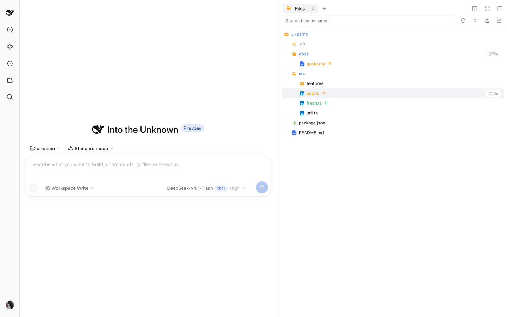
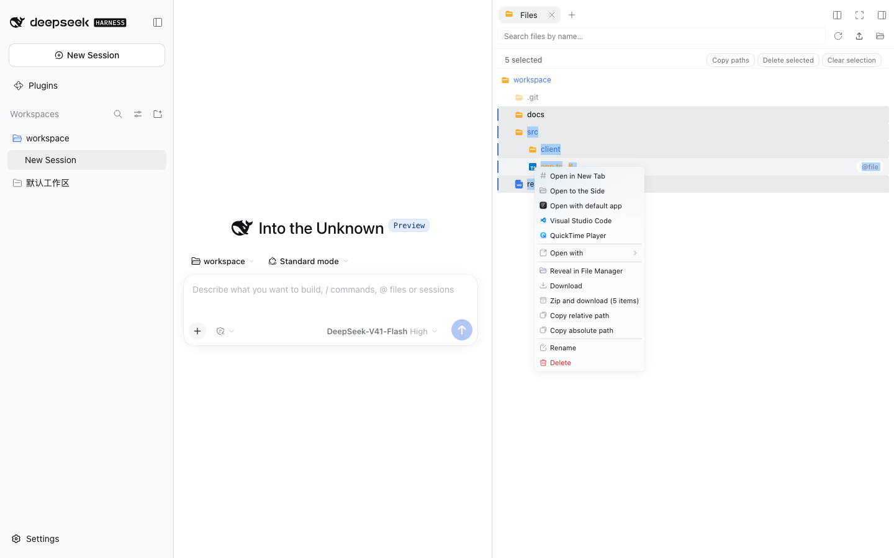
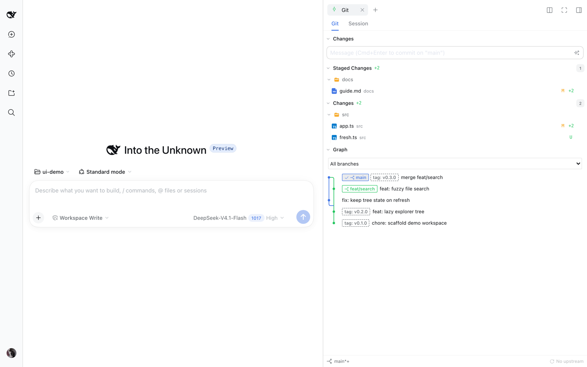

# dsh-better-sidebar

<div align="center">
  <b style="font-size: 1.15em;">DSH のためのデュアルワークベンチ：ネイティブの右サイドバー + 自前描画のボトムパネル、そして <code>ctx.betterSidebar</code> サービスをすべてのプラグインに公開します</b><br /><br />
  <a href="https://www.npmjs.com/package/dsh-better-sidebar"></a>
  <a href="https://www.npmjs.com/package/dsh-better-sidebar"></a>
  <a href="https://github.com/omdsh-dev/DSH-better-sidebar/actions/workflows/ci.yml"></a>
  <a href="https://github.com/omdsh-dev/DSH-better-sidebar/stargazers"></a>
  <a href="https://opensource.org/licenses/MIT"></a>
  <a href="https://www.npmjs.com/package/@deepseek-ai/dsh?activeTab=versions"></a>
</div>

<div align="center">
  🌏 <a href="./README_ZH.md">中文</a> · <a href="./README.md">English</a> · <a href="./README_JA.md"><b>日本語</b></a>
</div>

<div align="center">
  <video src="https://github.com/user-attachments/assets/23187822-047e-45cc-b480-fe997bd55b86" muted autoplay loop playsinline controls width="100%"></video>
</div>

## ✨ 機能

| | |
|---|---|
| **🗂️ ファイル管理**<br/>遅延読み込みのツリー、git ステータスの色分け、ディレクトリのライブ監視、グローバル検索、ドラッグ＆ドロップでのアップロード、複数選択による一括操作、2 つのソースを持つ「アプリで開く」メニュー。<br/><br/> | **🌿 Git**<br/>ソース管理（マージの変更 / ステージ済みの変更 / 変更のグループ、生成ボタン付きのメッセージ欄、ブランチ + 同期フッター）に加え、このセッションで AI が行った変更を表示するレンズ、そして**読み取り専用のコミットグラフ**（レーン、ブランチとタグのバッジ、ブランチフィルター、コミット詳細）を 1 つのタブにまとめています。<br/> |
| **📝 編集可能なエディターとプレビュー**<br/>編集可能な CodeMirror（標準のプレビューは読み取り専用です）、Markdown + Mermaid + フローティングアウトライン、サンドボックス化された HTML プレビュー、`.jsonl` のレコードカード、巨大ファイルのページ分割プレビュー、サイズ上限のないストリーミング転送。<br/> | **🧩 タスク**<br/>サブエージェントのライブトポロジー（ワークフローグラフ / ツリーモード）+ バックグラウンドタスク一覧：終了コード、ライブ出力、強制終了。<br/> |
| **💬 サイドチャット（beta）**<br/>Codex 風のサイドスレッド：親の完全なコンテキストを引き継いで独立して実行され、リアルタイムのプッシュ、見える化され取り消し可能なキュー、スレッドごとのモデル選択、ワンクリックでのトップレベルセッションへの昇格に対応します。デフォルトでは 1 つの共有ネイティブページを使い、設定でスレッドごとに 1 ページへ切り替えられます。<br/> | **🖥️ ボトムワークベンチ**<br/>ネイティブの右サイドバーと共存する自前描画のボトムパネル：ドラッグによるペイン分割、複数のターミナルタブ、セッションごとに永続化されるレイアウト。<br/> |

**その他**：📂 `sidebar_open` ツールでモデル自身がサイドバーを開けます · ⚡ 起動時のコアは約 325KB、重いチャンクは必要に応じて読み込まれます · 🌏 i18n は DSH に追従します · 📱 狭い画面では全幅のドロワーに切り替わります

- **🔗 チャット内の Markdown パス**：各ターンの最終アシスタントメッセージで、インラインコード内の完全な絶対パスの `.md` / `.markdown` がクリック可能になり、現在のセッションのファイルアドレスを通じてネイティブサイドバーで開きます。存在しないファイルは読み込みエラーを表示します。

### 🌿 Git グラフ（読み取り専用のコミットグラフ）

Git パネル上部の **グラフ** に切り替えると、ローカルブランチ、リモート追跡ブランチ、HEAD にまたがるコミットノード、分岐、マージのエッジを表示できます。ブランチセレクターは履歴を絞り込むだけで、**チェックアウトやフェッチは決して行いません**。各コミットは 1 行（レーンのエッジ + 参照のピル + 件名）で表示され、ホバーすると作者と短縮ハッシュが表示され、選択するとその完全なメッセージと差分がボトムペインに開きます。履歴はページ単位で読み込まれ、ページ送り中に参照が変わると更新を促します。読み込みには上限があり（1 ページあたり 200 コミット、オフセット 10,000、ブランチ 1,000）、上限を超えると明示的なエラーを報告します。軽量タグと注釈付きタグはグラフ上のコミットに表示され、行と詳細ではニュートラルなタグのピルを使い、タグが変わるとページ送りは無効化されます。タグの装飾は ref 名順で最初の 5,000 件までを保持し、さらに 8 MiB の完全な行単位の出力プレフィックスで制限されます。超過したタグはグラフを失敗させることなく省略されます。

### 🧭 dsh-context 診断（オプション）

`dsh-context` プラグインをインストールしていると、3 か所からその会話の **コンテキスト** ビューへワンクリックでジャンプできます：タスクページにあるエージェントノードの詳細カード、バックグラウンドジョブの出力ウィンドウ（そのジョブの本当の所有セッションであり、単にその行が監視されていたセッションではありません）、そしてセッションヘッダーです。これらの入口は dsh-context の `Context` ページが実際に登録されている間**だけ表示されます**。それがない（またはそのページが非表示の）デプロイではコントロールは一切表示されず、ジャンプの処理中はすべての入口が無効になります。ジャンプの失敗はフレーム下端の閉じられるアラートで 1 回だけ報告され、アイドル中は何もポーリングしません。

## 🚀 インストール

```sh
dsh plugin --profile web add dsh-better-sidebar@latest
```

その後、**ブラウザをハードリフレッシュ**してください（Cmd/Ctrl+Shift+R）。DSH **0.2.2-rc.3+** が必要です。

> **互換性の警告 — プラグインをホストのラインに合わせてください。** 2026-11-24 時点で、DSH の npm `latest` と `next` はどちらも **0.2.2-rc.5** です。**v0.33.0 には DSH 0.2.2-rc.3+ が必要です**。**0.2.2-rc.2** のホストは `dsh-better-sidebar@0.32.1` に、**0.2.2-rc.1** のホストは `dsh-better-sidebar@0.32.0` に固定する必要があります。0.2.1 ライン（**0.2.1-rc.1 ~ rc.5**）のホストは `dsh-better-sidebar@0.28.2` に固定する必要があります — v0.29.0 は npm に公開されていません。DSH 0.2.1-alpha.5 のユーザーは `dsh-better-sidebar@0.28.0-alpha.0` に、まだ **0.2.0-rc.2** のホストは `dsh-better-sidebar@0.26.1` に固定する必要があります。0.x のキャレットはマイナーバージョンをまたがないため、1 つのプラグインビルドで 2 つのホストラインには対応できません。マーケットプレイスのインストーラーはホストのバージョンにかかわらずプラグインの `latest` を選ぶため、古いホストではバージョン拒否エラーになります — ホストをアップグレードするか、バージョンを明示的に固定してください。2 つのパッケージの `latest` タグは互いに独立しています。

<details>
<summary><b>DSH のバージョンに合わせてプラグインのバージョンを選ぶ</b></summary>

| お使いの DSH バージョン | インストールコマンド |
| --- | --- |
| **0.2.2-rc.3+** | `dsh plugin --profile web add dsh-better-sidebar@0.33.0` |
| **0.2.2-rc.2** | `dsh plugin --profile web add dsh-better-sidebar@0.32.1` |
| **0.2.2-rc.1** | `dsh plugin --profile web add dsh-better-sidebar@0.32.0` |
| **0.2.1-rc.1 ~ 0.2.1-rc.5** | `dsh plugin --profile web add dsh-better-sidebar@0.28.2` |
| **0.2.1-alpha.5** | `dsh plugin --profile web add dsh-better-sidebar@0.28.0-alpha.0` |
| **0.2.0-rc.2** | `dsh plugin --profile web add dsh-better-sidebar@0.26.1` |
| **0.2.0-rc.1** | `dsh plugin --profile web add dsh-better-sidebar@0.24.1` |
| **0.1.7-rc.1 ~ 0.1.7 stable** | `dsh plugin --profile web add dsh-better-sidebar@0.22.1` |
| 0.1.7-alpha.x | 互換性のあるリリースはありません — まず DSH を rc.1 にアップグレードしてください |
| 0.1.6 以前（0.1.5 ラインを含む） | `dsh plugin --profile web add dsh-better-sidebar@0.19.1` |

古いリリースでは常に**正確なバージョン**を固定してください（`latest` は新しい安定版が出るたびに進みます）。`web` はご自身のプロファイル名に置き換えてください。

</details>

<details>
<summary><b>その他のインストール方法</b></summary>

**DSH にインストールしてもらう** — 次のプロンプトを任意の DSH セッションに貼り付けてください：

```text
Install the dsh-better-sidebar plugin (a sidebar workbench for DSH):
1. Confirm DSH is 0.2.2-rc.3 or newer, then run dsh plugin --profile web add dsh-better-sidebar@0.33.0
2. Remind me to hard-refresh the browser (Cmd/Ctrl+Shift+R) afterwards
If something fails, check the FAQ table in https://github.com/omdsh-dev/DSH-better-sidebar README first.
```

**ワンラインスクリプト** — このリポジトリをクローンして `bash scripts/install.sh 0.33.0` を実行します（macOS / Linux / Windows Git Bash。ネイティブの Windows では `./scripts/install.ps1 -Version 0.33.0`）。インストールとバンドルの登録を行います。

**アップデート**：インストールコマンドを再実行し、ブラウザをハードリフレッシュするだけです。

</details>

<details>
<summary><b>FAQ</b></summary>

| 症状 | 原因と対処 |
|---|---|
| `Ignored build scripts` エラー | pnpm 11 が推移的依存関係のビルドスクリプトをブロックしました。プロファイルディレクトリ（`~/.dsh/profiles/web`）で `pnpm approve-builds` を実行してください — このプラグイン自体にはビルドスクリプトを持つ依存関係はありません。 |
| `minimum release age` / バージョンが 24 時間未満 | リリースから 24 時間経っていません。24 時間待つか、再実行してください（pnpm が `minimumReleaseAgeExclude` を自動で追加します）。 |
| 「Profile directory not found」 | 一度 `dsh web` を実行して `~/.dsh/profiles/web` を初期化してください。 |
| 起動時にホストが停止する：`DesktopHostFatalError: … required plugins did not activate / better-sidebar` | プロファイルが独自の `@deepseek-ai/dsh-*` のコピーを持っており（古い DSH の残り、またはプロファイルの `package.json` / overrides に記載されたもの）、それらがインストール本体より先に解決されるため、このプラグインが静的に import する `dsh-subagent` が混在したセットにバインドされます。エクスポートが欠けているとき、ホストはこの致命的エラーを報告するだけでパッケージ名を示しません。現在のプラグインに同梱されているチェックで確認してください：`node ~/.dsh/profiles/web/node_modules/dsh-better-sidebar/scripts/check-profile-host-tree.mjs ~/.dsh/profiles/web`。対処：プロファイルの `package.json` / overrides から `@deepseek-ai/dsh-*` を削除してそこで `pnpm install` を実行する（するとインストール本体がそれらを提供します）か、両方のコピーを 1 つのバージョンに揃えてから再起動してください。インストールスクリプトはこのチェックを自動で実行します。 |
| ページに**サイドバーが 2 つ**表示される | 二重マウントです。`~/.dsh/profiles/web/cordis.patch.yml` から古い手動マウント行（`- insert: ... better-sidebar ...`）を削除してください。このパッケージを別の id でマウントしている集約パッケージは自動的に譲るため、対応は不要です。 |
| アップグレード後に設定値が消えた | DSH 0.1.7 以降、設定はプロファイル内のこのプラグインのマウント行（デフォルトのエントリ id は `better-sidebar`）に保存されます。プラグインは初回起動時に古い `settings.yaml` の値を一度だけ移行し、より新しい値を上書きすることはありません。 |
| ターミナルが使えない | ターミナルは **DSH 自体**が提供しています（このプラグインは PTY を同梱していません）— DSH のドキュメントを参照してください。ボトムターミナルに「host provides no terminal capability」と表示される場合、このデプロイにはターミナルコントローラーがマウントされていません。 |
| `dsh: command not found` | まず DSH をインストールしてください。または `npx -y --package @deepseek-ai/dsh@0.2.2-rc.3 dsh plugin --profile web add dsh-better-sidebar@0.33.0` を使ってください。 |

</details>

## 🆕 最近の更新

**v0.33.0 — サイドチャットのツールツリー、インストール下限、UI 修正のまとめ**

- **サイドチャットが PTC（`run_code`）のツールツリーを描画**：折りたたまれた行にはモデルの説明が表示され、展開するとプログラムとその最終結果が表示され、そこから呼び出された bash / read / grep / edit の呼び出しがインデントされてその下にぶら下がります。
- **インストールの下限が `engines.dsh`（DSH 0.2.2-rc.3+）になりました**：古いホストはプラグインの不具合として扱われるのではなく、プラグインマーケットで DSH をアップグレードするよう案内されます。0.2.2-rc.2 のホストは v0.32.1 のままです。
- **UI の修正**：サイドバーが全画面になるとボトムワークベンチが自動で折りたたまれ、ファイルツリーの検索ヘッダーがセッションタブの罫線と揃い、ネイティブタブのアイコンがホストのタイトルのジオメトリと一致し、タスクグラフのビュー切り替えが再び正方形になり、変更レンズの切り替えが下線付きタブに戻りました。
- **その他**：「タブプラグインを追加」のカタログに 9 件のエントリが追加され、公開パッケージは `ws` / `yaml` だけをインストールするようになったため、インストールサイズが大幅に小さくなりました。

**v0.32.1 — DSH 0.2.2-rc.2 との互換性**

- **右クリックメニューと「アプリで開く」メニューがホストの新しい配置方式に追従**：DSH 0.2.2-rc.2 は古い矩形コールバックを CSS アンカー方式のメニューに置き換え、サブメニューを独自のポータルに移したため、サイドバーはサブメニューのジオメトリを上書きせず、ホストに配置を任せるようになりました。
- **チームのタスクボードが組み込みの Agent Team サービスを通じて書き込むように**：オプトインの実験的なチームパッケージは、ベース構成の `@deepseek-ai/dsh-agent-team` になり、セッションごとのチームモードを備えています。
- **プラグインページにイラスト付きの詳細を表示**：右サイドバーの概要と会話ごとの分離を示す図があり、各ツールに番号付きの注記が付いています。
- **DSH 0.2.2-rc.1 のホストはプラグイン v0.32.0 のままです**。0.2.2-rc.2+ ではこのリリースを使ってください。

**v0.32.0 — プラグイン独自のスタートページとカードの磨き込み**

- **右サイドバーのスタートページがプラグイン独自のものに**：レスポンシブな 2 カラムグリッド、設定可能な行数（デフォルト 6）、並べ替え付きの常設「その他」カード、中央 / 上揃え、そしてデフォルトでオンの引き継ぎスイッチ（オフにするとホストのページに戻ります）。
- **ホストのスタートページのアクションは維持されます**：ターミナルカードはネイティブのシェルメニューを保ち、「その他」は「Browse more plugins」/「Create your plugin」を復元し、Better Sidebar のタブはサイドバーコンテンツのカードと同じ有効化スイッチを共有します。
- **カードのサブタイトルは 1 行に収まり**、省略記号で切り詰められ、「その他」メニューのアイコンはラベルと縦方向に中央揃えされます。
- **v0.30.1 以降に含まれるもの**：Markdown の `data:`/`file://` 画像、デスクトップシェルでの HTML プレビューのインライン化、組み込みの音声 / 動画プレビュー、サイドチャットの全面改修、データ安全性の修正、線形時間の差分ハイライター。

## 🔌 プラグインエコシステム

`ctx.betterSidebar` はすべてのプラグインに 5 つの拡張ポイントを提供します — `registerTab` / `registerFileViewer` / `registerFileIcon` / `registerFileAction` / `registerTabAction`。組み込みの 6 つのタブ + 5 つのビューアーもまったく同じ API を使っています。GitHub トピック [`dsh-better-sidebar`](https://github.com/topics/dsh-better-sidebar) にはすでに **30 以上のエコシステムプラグイン**が掲載されています。統合ガイドの全文は **[docs/external-plugin-guide.md](./docs/external-plugin-guide.md)** にあります。

```ts
import type {} from 'dsh-better-sidebar'  // triggers the ctx.betterSidebar type merge
export const inject = ['betterSidebar']
export function apply(ctx: Context) {
  ctx.effect(() => ctx.betterSidebar.registerTab({
    id: 'my-plugin:db', title: 'Database', component: ({ scope }) => <DbView sessionId={scope.sessionId} />,
  }))
}
```

<details>
<summary><b>エコシステムカタログ（タブプラグイン 28 件 · ビューアープラグイン 4 件 · 拡張 5 件）</b></summary>

### 📑 タブプラグイン（サイドバーページ）

| プラグイン | ⭐ | 説明 |
|---|---|---|
| [ChenRuoT/dsh-sidebar-qa](https://github.com/ChenRuoT/dsh-sidebar-qa) |  | 選択して質問するサイドページ：Codex 風のサイド質問 / Claude Code の `/btw` |
| [fuhefei/dsh-sentinel](https://github.com/fuhefei/dsh-sentinel) |  | 条件駆動のウェイクアップシステム：ファイル / コマンド / HTTP / プロセス / webhook のウォッチャーがエージェントを起こします。ドック + サイドバーのブランチ + グローバルダッシュボード |
| [Fisfzy/ego-browser](https://github.com/Fisfzy/ego-browser) |  | エージェントブラウザー：i18n 対応のローカルブラウザータブ（better-sidebar があればサイドバーページを自動登録し、なければフローティングのオブザーバーにフォールバック） |
| [jiuge2467/dsh-studio](https://github.com/jiuge2467/dsh-studio) |  | フルスタックのワークベンチ：マルチソースの MCP ビジュアルデバッグハブ、ビジュアル思考エンジン |
| [Iwctwbh/dsh-flowglass](https://github.com/Iwctwbh/dsh-flowglass) |  | Flowglass：リアルタイムのセッションフロー可視化（メッセージ / ツールグループ / サブエージェントのブランチ） |
| [FeatherHunter/dsh-mattpocock-skills-deck](https://github.com/FeatherHunter/dsh-mattpocock-skills-deck) |  | ゲーム化された mattpocock/skills のタスクシステム：戦場の霧マップ、タスクバーによる進行 |
| [GULI-lab/DSH-element-source](https://github.com/GULI-lab/DSH-element-source) |  | 任意の UI 要素をクリックすると、その Vue / React / Svelte / Angular のソースにジャンプし、セッションに渡します |
| [Lzh3070/dsh-file-review-tab](https://github.com/Lzh3070/dsh-file-review-tab) |  | ファイルレビューページ：行レベルの赤 / 緑の差分 + 取り消し + チャットの行へのディープリンク |
| [yq04/dsh-git-remotes](https://github.com/yq04/dsh-git-remotes) |  | Git リモートページ：ブランチ / アップストリーム / ahead-behind、prune 付きの fetch、ff-only の pull、確認付きの push |
| [ztyhehe/dsh-better-sidebar-svn](https://github.com/ztyhehe/dsh-better-sidebar-svn) |  | SVN のソース管理ページ：status / diff / log / commit / update / revert / 競合解決。組み込みの Git パネルと対になる構成 |
| [Melody-max114/dsh-excel-panel](https://github.com/Melody-max114/dsh-excel-panel) |  | Excel 編集ページ：xlsx のプレビュー / 編集、数式のライブ評価、結合セル、元のファイルへの保存 |
| [v587d/dsh-anysearch-refs](https://github.com/v587d/dsh-anysearch-refs) |  | AnySearch の結果参照カード：クエリ、ソースの要約、キーワードのハイライト |
| [Lukeknow0/dsh-markdown-link-preview](https://github.com/Lukeknow0/dsh-markdown-link-preview) |  | Markdown 成果物のリンクプレビュー：チャット内の同一オリジンの `.md` 出力をクリックしてサイドバーで読めます |
| [mlosun/dsh-docs-panel](https://github.com/mlosun/dsh-docs-panel) |  | グローバルなドキュメントパネル：どのワークスペースからでも読めるポータブルな Markdown ノート |
| [tylina/dsh-tylina](https://github.com/tylina/dsh-tylina) |  | Typst ドキュメントツール：論文、レポート、試験、履歴書、グラフ、ポスター、楽譜、PPTX にエクスポートできるスライドのための WYSIWYG 組版 |
| [lnyuqian/dsh-skill-sidebar](https://github.com/lnyuqian/dsh-skill-sidebar) |  | スキルパネル：ローカルのスキルディレクトリをスキャンし、短いアクションフレーズ + ワンクリックコピー + ピン留め |
| [g-yixuan/dsh-sidenote](https://github.com/g-yixuan/dsh-sidenote) |  | サイド質問を掘り下げ、返信に注釈を付け、ドキュメントの抜粋や役立つ Q&A をメインの会話に持ち帰れます |
| [OMSociety/dsh-ssh-tunnel](https://github.com/OMSociety/dsh-ssh-tunnel) |  | 複数ホストの SSH トンネル + SSH 管理ページ |
| [OMSociety/dsh-git-forge](https://github.com/OMSociety/dsh-git-forge) |  | GitHub / Gitea のアカウント、プロジェクトの認可、push ポリシー |
| [YesSanSan/dsh-conversation-outline](https://github.com/YesSanSan/dsh-conversation-outline) |  | 会話アウトラインページ：ターン単位で構造化されたビュー、ワンクリックジャンプ、LLM による 1 行タイトル |
| [Wulabalabo/dsh-sidebar-Explorer-Plus](https://github.com/Wulabalabo/dsh-sidebar-Explorer-Plus) |  | ファイルマネージャーページ：アップロード / 移動 / 削除 / 名前変更 / 新規フォルダー（書き込み操作） |
| [yq04/dsh-turn-review](https://github.com/yq04/dsh-turn-review) |  | ターンレビュー：エージェントの変更をターンごとにレビュー |
| [Ghz114514/dsh-refpics](https://github.com/Ghz114514/dsh-refpics) |  | Pinterest 風の参考画像検索：メイソンリーレイアウト、サイドバーのボード、ダウンロードと Eagle へのお気に入り登録 |
| [yzlin499/dsh-yzlin499-easy-plugins](https://github.com/yzlin499/dsh-yzlin499-easy-plugins) |  | 便利なユーティリティ集（最小構成の DSH にも優しい） |
| [dong-victor/dsh-better-sidebar-starter](https://github.com/dong-victor/dsh-better-sidebar-starter) |  | 実行構成ページ：IDEA 風の Run/Debug 構成 — ワンクリック起動、履歴、WebSocket によるライブログ、並列インスタンス |
| [baosfeng/my-dsh-plugins](https://github.com/baosfeng/my-dsh-plugins) |  | 個人のプラグイン集（`dsh-file-activity`）：サイドバーのファイルアクティビティページ — 読み取り / 作成 / 変更の履歴と統計 |
| [Hoemr/dsh-better-overleaf](https://github.com/Hoemr/dsh-better-overleaf) |  | Overleaf タブ：CDP ブラウザーでのログイン、プロジェクト切り替え、双方向同期するローカル git ミラー |
| [Andor-Z/dsh-turn-outline](https://github.com/Andor-Z/dsh-turn-outline) |  | ターントレースページ：セッションをユーザーのターンごとに折りたたみ、任意のステップをクリックするとチャット内の位置に戻ります。LLM 不使用、読み取り専用 |

### 🖼️ ビューアープラグイン（ファイルビューアー）

| プラグイン | ⭐ | 説明 |
|---|---|---|
| [HuanLinOTO/dsh-plugin-better-sidebar-plugin-office](https://github.com/HuanLinOTO/dsh-plugin-better-sidebar-plugin-office) |  | Office 3 形式のプレビュー（.docx / .xlsx / .pptx）。軽量な独立バンドルとして提供 |
| [HuanLinOTO/dsh-plugin-better-sidebar-plugin-audio](https://github.com/HuanLinOTO/dsh-plugin-better-sidebar-plugin-audio) |  | 音声プレビュー：ズーム可能な波形プレーヤー + リアルタイムスペクトラム、HTTP Range ストリーミングのルート、どのサイズでもシーク可能 |
| [zemul/dsh-video-preview](https://github.com/zemul/dsh-video-preview) |  | インラインの動画プレビュー：.mp4 / .webm / .mov / .mkv / .avi を HTTP Range でシーク |
| [dong-victor/dsh-better-sidebar-jupyter](https://github.com/dong-victor/dsh-better-sidebar-jupyter) |  | 実行可能な `.ipynb` ノートブックビュー：遅延起動の Python カーネル、ストリーミング出力、保存 |

### 🧰 拡張とツール

| プラグイン | ⭐ | 説明 |
|---|---|---|
| [eg-bole/dsh-better-sidebar-icons](https://github.com/eg-bole/dsh-better-sidebar-icons) |  | VSCode 風のファイル / フォルダーアイコンテーマ（vscode-icons の移植、純粋な DOM オーバーレイ、侵襲ゼロ） |
| [dong-victor/dsh-better-sidebar-terminal-plus](https://github.com/dong-victor/dsh-better-sidebar-terminal-plus) |  | ターミナルの拡張：Nerd Font アイコンの同梱、xterm のアイコン描画の修正、安定したターミナルの cwd |
| [Max-Null/dsh-sidebar-preview-select](https://github.com/Max-Null/dsh-sidebar-preview-select) |  | プレビューの選択強化：サイドバーのプレビューでテキストを選択 → フローティングの「セッションに送る」 |
| [Hoemr/dsh-quicklook](https://github.com/Hoemr/dsh-quicklook) |  | QuickLook 風の Space プレビュー：アクティブなファイルタブで Space を押すと画像 / PDF / テキストをフルサイズで表示 |
| [ionaryu/dsh-copy-document](https://github.com/ionaryu/dsh-copy-document) |  | ドキュメント全体のコピー：保存の右にあるコントロールひとつで、ビューポートに表示されている部分だけでなくファイル全体をクリップボードにコピーします（5 MB を超える場合はページ単位） |

</details>

> 📣 **プラグインを掲載する**：リポジトリに `dsh-better-sidebar` トピックを付けると [トピックページ](https://github.com/topics/dsh-better-sidebar) に表示されます。さらに [`src/client/plugins-tabs.ts`](./src/client/plugins-tabs.ts) / [`plugins-viewers.ts`](./src/client/plugins-viewers.ts) に `PluginEntry` を追加する PR を送ると、アプリ内のおすすめカタログに加わります。

<details>
<summary><b>⌨️ キーボードショートカット</b></summary>

| 操作 | キー |
|---|---|
| エディターを保存 | `Ctrl/Cmd + S` |
| ファイル内の検索 / 置換 | `Ctrl/Cmd + F` |
| 次 / 前を検索 | `Ctrl/Cmd + G` / `Shift + Ctrl/Cmd + G` |
| 次の出現箇所を選択 | `Ctrl/Cmd + D` |
| Git コミット | `Ctrl + Enter` |
| タブを閉じる | 中クリック |
| ペインの分割 / 結合 | タブをペインの端 / 中央にドラッグ |
| 入力欄でファイルを参照 | 行にホバー → `@file` ボタン |

</details>

<details>
<summary><b>🔐 セキュリティと ⚠️ 既知の制限</b></summary>

- ルートは Host ヘッダーの信頼フェンス（`/api` と同じ）の内側にあります。`fs.write` はアトミックです。git は CLI 経由でのみ呼び出され、ID を設定することはありません
- ⚠️ **v0.23.0 以降、fs ルートはワークスペース内に収まっているかのチェックを行いません**：ホストのユーザーが到達できる任意のパスを読み書きできます（OS の権限のみ）— 呼び出し側はこれらのルートをフェンスで守られたものとして扱わないでください
- HTML プレビューは**不透明オリジンのサンドボックス化された iframe** で描画され、相対パスの CSS、JavaScript、JSON、フォント、WebAssembly をそれぞれのコンテンツタイプで配信します。サンドボックスは設定で機能ごとに無効化できます（デフォルトはオフで、警告が表示されます）
- git の push/pull/fetch はありません。ファイルツリーは**展開された**ディレクトリのみを監視します。Markdown プレビューは保存済みのファイルを描画します
- 読み取り専用の形式（スプレッドシート / PDF / 画像 / Office）は DSH 自身のドキュメントプレビューで描画され、ホストのバージョンに従います。ブラウザービューはデスクトッププロファイルにのみ存在します
- 未保存の下書きは、タブを閉じる / ファイルを削除する / 更新する前に確認されます。外部で変更された後の保存は拒否され、黙って上書きされることはありません
- モバイル（<768px）ではボトムパネルはありません — そのタブは右サイドバーの全幅ドロワーに統合されます

</details>

<details>
<summary><b>🛠️ 開発とビルド</b></summary>

```sh
pnpm install      # @deepseek-ai/* devDependencies are published, resolves directly
pnpm typecheck && pnpm lint && pnpm build && pnpm test
make check        # aggregate gate (matches CI)
make mount        # real-mount smoke: build + pack → pnpm test:mount
```

**アーキテクチャ**：ホスト / クライアントの 2 つの部分を持つ単一の npm パッケージです — ホスト（`src/index.ts`）：`/sidebar/api/*` の JSON API、メディア / HTML プレビュー / アップロードのルート、2 つの WebSocket。クライアント（`src/client/index.tsx`）：ネイティブの右サイドバーのタブ + ボトムワークベンチ。状態はセッションごとに localStorage に永続化されます。リポジトリのルール：[`AGENTS.md`](./AGENTS.md)。

Windows / Linux / macOS に対応しています（macOS は日々検証しており、それ以外はユニットテストと Windows CI でカバーしています）。ネイティブ依存関係はありません — ビルドに必要なのは Node ≥ 20 + pnpm ≥ 10 だけです。

</details>

## 💬 コミュニティ

QQ グループ：577011007

<div align="center">
  
  
</div>

## 🤝 コントリビューション

- **コードの変更は PR を通します**：`feat/*` / `fix/*` ブランチで開発 → `gh pr create`。提出前に `pnpm typecheck && pnpm build && pnpm test`（または `make check`）を実行してください
- **エコシステムプラグインを掲載する**：リポジトリに `dsh-better-sidebar` トピックを付け + [`src/client/plugins-tabs.ts`](./src/client/plugins-tabs.ts) / [`plugins-viewers.ts`](./src/client/plugins-viewers.ts) にエントリを追加する PR を送ってください
- リポジトリのルール：[`AGENTS.md`](./AGENTS.md)

## 👥 コントリビューター

<a href="https://github.com/omdsh-dev/DSH-better-sidebar/graphs/contributors">
  
</a>

現在の未リリースサイクルのテキスト一覧：[CONTRIBUTORS.md](./CONTRIBUTORS.md)。

## 🔗 フレンズ

- [dsh-tianshu-tui](https://github.com/huiliyi37/dsh-tianshu-tui)：DeepSeek Harness 向けの対話型ターミナル UI プラグイン。TDD とエビデンスゲートのワークフローを備えています
- [dsh-TUI](https://github.com/ccch1mneyyy/dsh-TUI)：Claude Code 風のフルスクリーンターミナルプラグイン — ピクセルアートのクジラのヘッダー、ストリーミングされる思考、コンテキストの進捗バー + TPS ゲージ
- [dshfind plugin store](https://dshfind.com/zh/plugins)：サードパーティのプラグインマーケット — `dsh-plugin` トピックの公開リポジトリを毎日同期
- [DeepSeek Harness Desktop Tauri](https://github.com/hairyf/deepseek-harness-desktop)：Tauri 製のデスクトップビルド — 5MB のインストーラー、セットアップ不要、プラグインはプリインストール済み
- [DeepSeek Harness Desktop](https://github.com/anywhere-labs/deepseek-harness-desktop)：モダンなデスクトップアプリ — Node.js を設定することなくローカルの Harness サービスを起動・管理できます。[ウェブサイト](https://www.dshdesktop.cn)

---

<div align="center">
  <sub>MIT License · <a href="https://github.com/deepseek-ai/deepseek-harness">DeepSeek Harness</a> エコシステムのために作られました · <a href="https://github.com/topics/dsh-better-sidebar">topic dsh-better-sidebar</a> でさらに多くのプラグインを見つけられます</sub>
</div>
