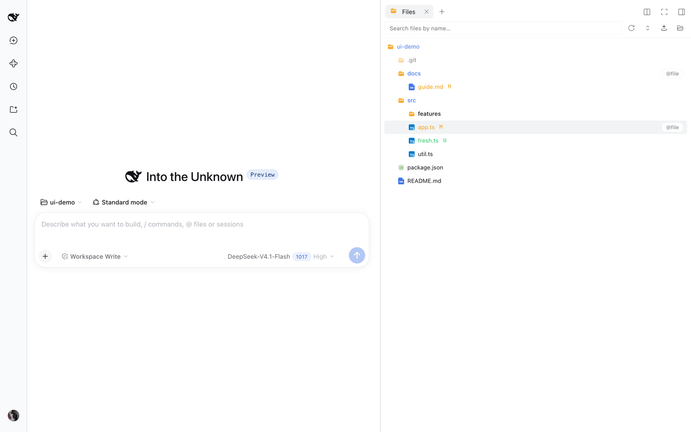
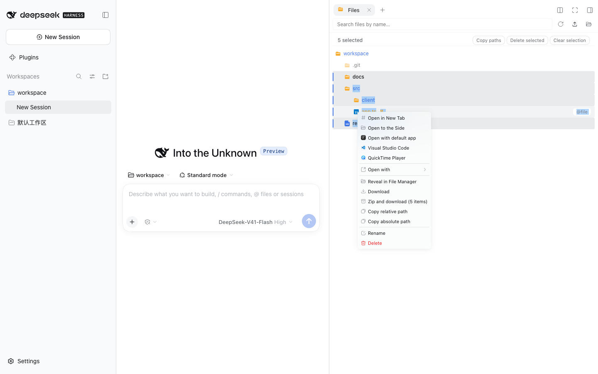
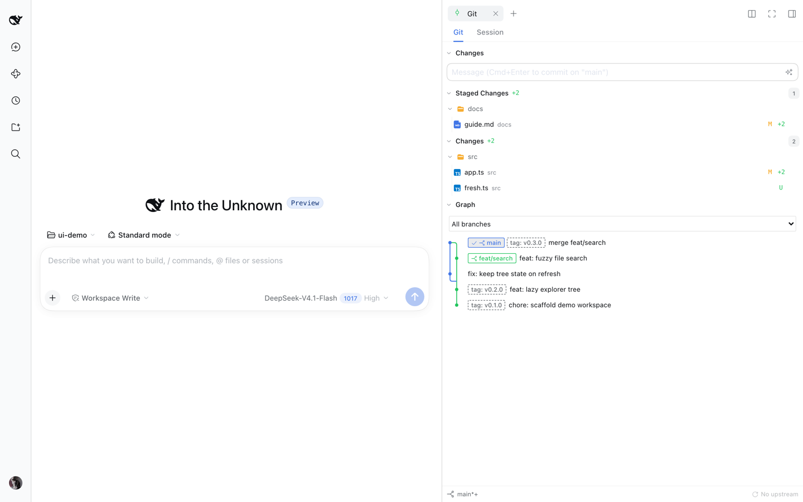

# dsh-better-sidebar

<div align="center">
  <b style="font-size: 1.15em;">DSH 的双工作台：原生右侧栏 + 自绘底部面板，并把 <code>ctx.betterSidebar</code> 服务开放给所有插件</b><br /><br />
  <a href="https://www.npmjs.com/package/dsh-better-sidebar"></a>
  <a href="https://www.npmjs.com/package/dsh-better-sidebar"></a>
  <a href="https://github.com/omdsh-dev/DSH-better-sidebar/actions/workflows/ci.yml"></a>
  <a href="https://github.com/omdsh-dev/DSH-better-sidebar/stargazers"></a>
  <a href="https://opensource.org/licenses/MIT"></a>
  <a href="https://www.npmjs.com/package/@deepseek-ai/dsh?activeTab=versions"></a>
</div>

<div align="center">
  🌏 <a href="./README_ZH.md"><b>中文</b></a> · <a href="./README.md">English</a>
</div>

<div align="center">
  <video src="https://github.com/user-attachments/assets/23187822-047e-45cc-b480-fe997bd55b86" muted autoplay loop playsinline controls width="100%"></video>
</div>

## ✨ 特色功能

| | |
|---|---|
| **🗂️ 文件管理**<br/>懒加载目录树、Git 变更着色、实时 watch 刷新、全局搜索、拖拽上传、多选批量操作、「打开方式」双源菜单。<br/><br/> | **🌿 Git**<br/>Source Control（Merge / Staged / Changes 三组、带 Generate 的消息框、分支与同步底栏）+ 本轮 AI 改动视角合一，并在同一页签内给出**只读提交图**（泳道、分支与 tag 徽章、分支筛选、提交详情）。<br/> |
| **📝 可编辑编辑器与预览**<br/>可编辑的 CodeMirror（官方预览是只读）、Markdown + Mermaid + 浮动目录、HTML 沙箱预览、`.jsonl` 记录卡片、超大文件分页预览、传输无大小上限。<br/> | **🧩 任务管理**<br/>子代理拓扑实时预览（工作流图 / 树双模式）+ 后台任务清单：退出码、实时输出、强制终止。<br/> |
| **💬 侧边对话（beta）**<br/>Codex 风格侧边线程：继承主会话完整上下文独立运行、实时推送、排队可见可撤回、每个线程独立选模型、一键提升为顶层会话。<br/> | **🖥️ 底部工作台**<br/>自绘底部面板与原生右侧栏同时展开：拖拽分栏、多终端页签、按会话持久化布局。<br/> |

**还有**：📂 `sidebar_open` 工具让模型主动打开侧边栏 · ⚡ 启动只拉 ~325KB 核心、重依赖按需加载 · 🌏 多语言跟随 DSH · 📱 窄屏自动切换全宽抽屉

### 🌿 Git Graph（只读提交图）

在 Git 面板顶部切到 **Git Graph**：本地分支、远程跟踪分支与 HEAD 的提交节点、分叉与合并连线。分支下拉框只筛选历史，**不会 checkout 或 fetch**；提交行是单行（泳道连线 + 引用徽章 + 标题），hover 看作者与短 hash，选中后在底部面板看完整提交信息与 diff。历史按页加载，分页期间 refs 变化会提示刷新；读取有上限（每页 200 条、偏移 10,000、分支 1,000），超限明确报错。图中提交支持 lightweight 与 annotated tag，提交行与详情通过中性 tag pill 标识，tag 变化会使旧分页失效。Tag 装饰按引用名保留前 5,000 条，并受 8 MiB 输出的完整行前缀限制；多余 tag 省略，不影响整张图加载。

### 🧭 dsh-context 诊断入口（可选）

装上 `dsh-context` 插件后，三处各有一个直达该会话 **Context（上下文）** 视图的入口：任务管理页的代理节点详情卡、后台任务输出窗（按任务的**真实属主会话**寻址，而不是它被挂在哪个会话名下）、以及会话标题栏。入口**只在** dsh-context 的 `Context` 页面确实注册时才出现——没装、没启用或该页面被隐藏的部署不会显示任何控件；一次跳转进行中时，三个入口一并禁用。跳转失败只报一条可关闭的提示（浮在窗口底部），空闲时不新增任何轮询。

## 🚀 安装

```sh
dsh plugin --profile web add dsh-better-sidebar@latest
```

装完**硬刷新浏览器**（Cmd/Ctrl+Shift+R）即可。要求 DSH **0.2.2-rc.1+**。

> **兼容性警告：插件版本必须与宿主线匹配。** 截至 2026-11-04，DSH 的 npm `latest` 是 **0.2.1-rc.5**、`next` 是 **0.2.2-rc.1**。**v0.30.0 要求 DSH 0.2.2-rc.1+**；仍停在 0.2.1 线（**0.2.1-rc.1 ~ rc.5**，也就是今天的 `latest`）的宿主必须固定 `dsh-better-sidebar@0.28.2`——v0.29.0 从未发布到 npm。DSH 0.2.1-alpha.5 用户固定 `dsh-better-sidebar@0.28.0-alpha.0`，**0.2.0-rc.2** 宿主固定 `dsh-better-sidebar@0.26.1`。0.x 的 caret 不跨 minor，因此一个构建无法同时服务两条宿主线。市场安装器按插件的 `latest` 安装、不按宿主版本选版本，旧宿主会收到版本拒绝错误——请升级宿主或显式固定版本。两个包的 `latest` 标签不是同一支持线。

<details>
<summary><b>按 DSH 版本选插件版本</b></summary>

| 你的 DSH 版本 | 安装命令 |
| --- | --- |
| **0.2.2-rc.1+** | `dsh plugin --profile web add dsh-better-sidebar@0.30.1` |
| **0.2.1-rc.1 ~ 0.2.1-rc.5** | `dsh plugin --profile web add dsh-better-sidebar@0.28.2` |
| **0.2.1-alpha.5** | `dsh plugin --profile web add dsh-better-sidebar@0.28.0-alpha.0` |
| **0.2.0-rc.2** | `dsh plugin --profile web add dsh-better-sidebar@0.26.1` |
| **0.2.0-rc.1** | `dsh plugin --profile web add dsh-better-sidebar@0.24.1` |
| **0.1.7-rc.1 ~ 0.1.7 正式版** | `dsh plugin --profile web add dsh-better-sidebar@0.22.1` |
| 0.1.7-alpha.x | 没有可装版本——先升级 DSH 到 rc.1 |
| 0.1.6 及更早（含 0.1.5 线） | `dsh plugin --profile web add dsh-better-sidebar@0.19.1` |

旧版本一律写**精确版本号**（`latest` 会随新正式版前移）。命令里的 `web` 换成你自己的 profile 名即可。

</details>

<details>
<summary><b>其他安装方式</b></summary>

**让 DSH 自己装**——把这段提示词发给任意一个 DSH 会话：

```text
帮我安装 dsh-better-sidebar 插件（DSH 侧边栏工作台），步骤：
1. 先确认 DSH 为 0.2.2-rc.1 或更新版本，再执行 dsh plugin --profile web add dsh-better-sidebar@0.30.1
2. 完成后提醒我硬刷新浏览器（Cmd/Ctrl+Shift+R）
遇到报错先查 https://github.com/omdsh-dev/DSH-better-sidebar README 的常见问题表。
```

**一键脚本**——克隆本仓库后执行 `bash scripts/install.sh 0.30.1`（macOS / Linux / Windows Git Bash；Windows 原生用 `./scripts/install.ps1 -Version 0.30.1`），自动完成安装 + bundle 注册。

**更新**：重跑一次安装命令即可，然后硬刷新浏览器。

</details>

<details>
<summary><b>常见问题</b></summary>

| 现象 | 原因与解决 |
|---|---|
| 报 `Ignored build scripts` | pnpm 11 拦截了某个传递依赖的构建脚本。在 profile 目录（`~/.dsh/profiles/web`）跑 `pnpm approve-builds` 按提示放行——本插件自身已无构建脚本依赖。 |
| 报 `minimum release age` / 版本不足 24h | 装的版本发布不足 24 小时。等 24h 或重跑一次（pnpm 会自动补 `minimumReleaseAgeExclude`）。 |
| 报「找不到 profile 目录」 | 先跑一次 `dsh web`，让它初始化 `~/.dsh/profiles/web`。 |
| 宿主启动即崩：`DesktopHostFatalError: … required plugins did not activate / better-sidebar` | profile 里自带了 `@deepseek-ai/dsh-*` 副本（旧 DSH 版本留下的，或被写进 profile 的 `package.json` / overrides），它们会抢在宿主安装之前被解析，本插件静态 import 的 `dsh-subagent` 因此绑到混搭版本；混版缺导出时宿主只报这条 fatal，看不到是哪个包缺了什么。先确认（新版插件随包提供）：`node ~/.dsh/profiles/web/node_modules/dsh-better-sidebar/scripts/check-profile-host-tree.mjs ~/.dsh/profiles/web`。修复：从 profile 的 `package.json` / overrides 移除 `@deepseek-ai/dsh-*` 后在该目录 `pnpm install`（让宿主安装提供），或把两份副本对齐到同一版本；然后重启。安装脚本会自动跑这条检查。 |
| 页面出现**两个侧边栏** | 双挂载。删掉 `~/.dsh/profiles/web/cordis.patch.yml` 里旧的手动挂载行（`- insert: ... better-sidebar ...`）；聚合包以不同 id 挂载本包时会自动退让，无需处理。 |
| 升级后设置页的值去哪了 | DSH 0.1.7 起偏好写在 profile 里本插件的挂载行上（默认 entry id `better-sidebar`），插件首次启动会把旧 `settings.yaml` 里的配置一次性回迁，不会覆盖新设的值。 |
| 终端无法使用 | 终端由 **DSH 自身**提供（本插件不自带 PTY），请查 DSH 侧文档；底部终端显示「宿主未提供终端能力」= 这个部署没挂终端控制器。 |
| 提示 `dsh: command not found` | 先安装 DSH；或用 `npx -y --package @deepseek-ai/dsh@0.2.2-rc.1 dsh plugin --profile web add dsh-better-sidebar@0.30.1`。 |

</details>

## 🆕 最近更新

**v0.30.1 — 设置导航图标修复**

- **设置页「侧边卡片」那一行不再显示两个图标**：插件此前用 CSS 遮罩盖住宿主的兜底齿轮、再画自己的图标；宿主的导航图标外层多了容器，同时也提供了按 section 挂图标的口子。现在图标走宿主插槽，标记 + 遮罩那一套整体删除（顺带去掉了一个全局 DOM 观察器）。

**v0.30.0 — 支持 DSH 0.2.2、侧边对话可发图、引用 chip 可点击**

- **基线抬到 DSH 0.2.2-rc.1**（14 条 peer 下限全部前移到 `^0.2.2-rc.1`）。宿主把可安装的模型选择 ref 换成了 agent 自有的 `AgentModel`，侧边对话的模型切换改走 `agent.model.select()`——只落盘一次，并作用于下一步。0.x 的 caret 不跨 minor：DSH 0.2.1 线（也就是今天的 npm `latest`）继续固定插件 v0.28.2。
- **侧边对话可以发图**：粘贴截图或选择 PNG / JPEG / WebP / GIF，发送前可预览、可移除，也可以只发图片；刷新页面或冷恢复后预览仍在。
- **引用 chip 可点击**：用「添加到对话」划选的一段文字会落成一枚 chip，点击跳回源文件并闪烁被引行段；带 nonce，所以连点两次仍会再次跳转。引用记录写不进存储时回退到原来的内置 chip，而不是落一枚点不动的死 chip。
- **草稿不再被宿主侧的关闭路径吞掉**：关闭原生侧边页签、或退出桌面端时，未保存草稿会被备份，重开同一文件时提示恢复——宿主没有可取消的关闭钩子，所以这是备份 + 恢复，不是弹窗拦截。
- **可靠性**：父会话压缩过之后开的侧聊不再写出不可读的会话日志；页面 CSS zoom 不再被误判为页面变换；底部工作台终端不再自带黑底；容器工作区在 Git 面板里能看到每个子仓库；安装脚本发现 profile 里 `@deepseek-ai/dsh-*` 版本混搭会直接拒绝并打印修复命令。

**v0.29.0 — 侧边对话接入 GenUI**

- 新增可选的 `registerSidechatSurfaceAdapter` 服务，配合 GenUI 0.15.0 在已结算的侧边回复里渲染交互组件；状态和动作归属对应子线程。
- 未安装消费插件、流式回复及不支持的围栏继续显示原 Markdown；保留 0.28.2 的冷会话读取修复。
- 配套实现由 [@sunxiuguo](https://github.com/sunxiuguo) 贡献，见 [#1033](https://github.com/omdsh-dev/DSH-better-sidebar/pull/1033)。

## 🔌 插件生态

`ctx.betterSidebar` 向所有插件开放 `registerTab` / `registerFileViewer` 两个扩展点，内置 6 tab + 4 viewer 与第三方插件走同一套 API。GitHub topic [`dsh-better-sidebar`](https://github.com/topics/dsh-better-sidebar) 下已有 **30+ 生态插件**；完整接入文档见 **[docs/external-plugin-guide.md](./docs/external-plugin-guide.md)**。

```ts
import type {} from 'dsh-better-sidebar'  // 触发 ctx.betterSidebar 类型合并
export const inject = ['betterSidebar']
export function apply(ctx: Context) {
  ctx.effect(() => ctx.betterSidebar.registerTab({
    id: 'my-plugin:db', title: 'Database', component: ({ scope }) => <DbView sessionId={scope.sessionId} />,
  }))
}
```

<details>
<summary><b>生态插件目录（28 个 Tab 插件 · 4 个预览插件 · 4 个增强工具）</b></summary>

### 📑 Tab 插件（注册侧边栏页面）

| 插件 | ⭐ | 简介 |
|---|---|---|
| [ChenRuoT/dsh-sidebar-qa](https://github.com/ChenRuoT/dsh-sidebar-qa) |  | 划选追问侧边页：类 Codex 侧边提问 / Claude Code `/btw` |
| [fuhefei/dsh-sentinel](https://github.com/fuhefei/dsh-sentinel) |  | 条件驱动唤醒系统：文件 / 命令 / HTTP / 进程 / Webhook 监视，到点唤醒 agent；dock + 侧栏分支 + 全局仪表盘 |
| [Fisfzy/ego-browser](https://github.com/Fisfzy/ego-browser) |  | Agent 浏览器：i18n 感知的本机浏览器 Tab（装了 better-sidebar 自动注册侧边栏页，未装回退浮动浮窗观察） |
| [jiuge2467/dsh-studio](https://github.com/jiuge2467/dsh-studio) |  | 全栈增强工作台：多源 MCP 可视化调试中枢、视觉思考引擎 |
| [Iwctwbh/dsh-flowglass](https://github.com/Iwctwbh/dsh-flowglass) |  | 流镜 Flowglass：会话流程图实时可视化（消息 / 工具组 / 子代理分支） |
| [FeatherHunter/dsh-mattpocock-skills-deck](https://github.com/FeatherHunter/dsh-mattpocock-skills-deck) |  | mattpocock/skills 游戏化任务系统：地图拨迷雾、任务栏推进 |
| [GULI-lab/DSH-element-source](https://github.com/GULI-lab/DSH-element-source) |  | 点击页面任意 UI 元素直达 Vue / React / Svelte / Angular 源码并送入会话 |
| [Lzh3070/dsh-file-review-tab](https://github.com/Lzh3070/dsh-file-review-tab) |  | 文件改动审查页：行级红绿 diff + 撤销 + chat 行深链 |
| [yq04/dsh-git-remotes](https://github.com/yq04/dsh-git-remotes) |  | Git 远程页：分支 / 上游 / ahead-behind，fetch 可 prune、ff-only pull、确认后 push |
| [ztyhehe/dsh-better-sidebar-svn](https://github.com/ztyhehe/dsh-better-sidebar-svn) |  | SVN 源码管理页：status / diff / log / commit / update / revert / 冲突解决，与内置 Git 面板对称 |
| [Melody-max114/dsh-excel-panel](https://github.com/Melody-max114/dsh-excel-panel) |  | Excel 编辑页：xlsx 预览 / 编辑、公式实时计算、合并单元格、保存回原文件 |
| [v587d/dsh-anysearch-refs](https://github.com/v587d/dsh-anysearch-refs) |  | AnySearch 搜索结果引用卡片：搜索词、来源摘要、关键词高亮 |
| [Lukeknow0/dsh-markdown-link-preview](https://github.com/Lukeknow0/dsh-markdown-link-preview) |  | Markdown 产物链接预览：点击聊天中的同源 `.md` 输出文件，直接在侧边栏阅读 |
| [mlosun/dsh-docs-panel](https://github.com/mlosun/dsh-docs-panel) |  | 全局文档面板：随身 Markdown 笔记，任何工作区随时可读 |
| [tylina/dsh-tylina](https://github.com/tylina/dsh-tylina) |  | Typst 文档编辑工具：WYSIWYG 编辑排版论文、报告、试卷、简历、图表、海报、乐谱和 PPTX 导出的 Slides |
| [lnyuqian/dsh-skill-sidebar](https://github.com/lnyuqian/dsh-skill-sidebar) |  | 技能面板：扫描本机技能目录，4-6 字功能短语 + 一键复制调用 + 置顶 |
| [g-yixuan/dsh-sidenote](https://github.com/g-yixuan/dsh-sidenote) |  | Codex 风格侧边对话 + 划选引用注释（轻量消费插件） |
| [OMSociety/dsh-ssh-tunnel](https://github.com/OMSociety/dsh-ssh-tunnel) |  | 多主机 SSH 隧道 + SSH 管理器页 |
| [OMSociety/dsh-git-forge](https://github.com/OMSociety/dsh-git-forge) |  | GitHub / Gitea 账号、项目授权与推送策略 |
| [YesSanSan/dsh-conversation-outline](https://github.com/YesSanSan/dsh-conversation-outline) |  | 对话大纲页：按轮次结构化展示、一键跳转、LLM 一句话标题 |
| [Wulabalabo/dsh-sidebar-Explorer-Plus](https://github.com/Wulabalabo/dsh-sidebar-Explorer-Plus) |  | 文件管理页：上传 / 移动 / 删除 / 重命名 / 新建文件夹（补全写操作） |
| [yq04/dsh-turn-review](https://github.com/yq04/dsh-turn-review) |  | 本轮审查：逐回合审查 agent 改动 |
| [Ghz114514/dsh-refpics](https://github.com/Ghz114514/dsh-refpics) |  | Pinterest 风格参考图搜索：瀑布流、侧栏画板、下载与 Eagle 收藏 |
| [yzlin499/dsh-yzlin499-easy-plugins](https://github.com/yzlin499/dsh-yzlin499-easy-plugins) |  | 实用小工具集（毛坯房 DSH 友好） |
| [dong-victor/dsh-better-sidebar-starter](https://github.com/dong-victor/dsh-better-sidebar-starter) |  | 运行配置页：IDEA 式 Run/Debug 配置——一键启动、历史保存、WebSocket 实时日志、多实例并行 |
| [baosfeng/my-dsh-plugins](https://github.com/baosfeng/my-dsh-plugins) |  | 个人多插件合集（`dsh-file-activity`）：侧边栏文件活动页——文件读取 / 新增 / 修改历史与统计 |
| [Hoemr/dsh-better-overleaf](https://github.com/Hoemr/dsh-better-overleaf) |  | Overleaf 标签页：直连 CDP 浏览器登录、项目切换、本地 git 镜像与双向同步 |
| [Andor-Z/dsh-turn-outline](https://github.com/Andor-Z/dsh-turn-outline) |  | 轮次轨迹页：按用户轮次折叠会话，点击任意步骤跳回对话原位；零 LLM、只读 |

### 🖼️ 预览插件（注册文件预览器）

| 插件 | ⭐ | 简介 |
|---|---|---|
| [HuanLinOTO/dsh-plugin-better-sidebar-plugin-office](https://github.com/HuanLinOTO/dsh-plugin-better-sidebar-plugin-office) |  | Office 三件套预览（.docx / .xlsx / .pptx），独立 bundle 瘦身主体 |
| [HuanLinOTO/dsh-plugin-better-sidebar-plugin-audio](https://github.com/HuanLinOTO/dsh-plugin-better-sidebar-plugin-audio) |  | 音频预览：可缩放波形播放器 + 实时频谱，HTTP Range 流式媒体路由，任意大小可拖进度 |
| [zemul/dsh-video-preview](https://github.com/zemul/dsh-video-preview) |  | 视频内联预览：.mp4 / .webm / .mov / .mkv / .avi，HTTP Range 拖进度条 |
| [dong-victor/dsh-better-sidebar-jupyter](https://github.com/dong-victor/dsh-better-sidebar-jupyter) |  | `.ipynb` 可运行 Notebook 视图：懒启动 Python kernel、流式输出、保存回写 |

### 🧰 增强与工具

| 插件 | ⭐ | 简介 |
|---|---|---|
| [eg-bole/dsh-better-sidebar-icons](https://github.com/eg-bole/dsh-better-sidebar-icons) |  | VSCode 风格文件 / 文件夹图标主题（vscode-icons 移植，纯 DOM 覆盖零侵入） |
| [dong-victor/dsh-better-sidebar-terminal-plus](https://github.com/dong-victor/dsh-better-sidebar-terminal-plus) |  | 终端增强：内嵌 Nerd Font 图标字体、修复 xterm 图标渲染、稳定终端 cwd |
| [Max-Null/dsh-sidebar-preview-select](https://github.com/Max-Null/dsh-sidebar-preview-select) |  | 预览划选增强：侧边栏预览里划选文本 → 浮动「发送到会话」 |
| [Hoemr/dsh-quicklook](https://github.com/Hoemr/dsh-quicklook) |  | QuickLook 式空格预览：活动文件标签页按 Space 全尺寸查看图片 / PDF / 文本 |

</details>

> 📣 **上架你的插件**：给仓库打上 `dsh-better-sidebar` topic 即出现在 [topic 页](https://github.com/topics/dsh-better-sidebar)；再向 [`src/client/plugins-tabs.ts`](./src/client/plugins-tabs.ts) / [`plugins-viewers.ts`](./src/client/plugins-viewers.ts) 提一条 `PluginEntry` PR，即可进入设置页内置推荐目录。

<details>
<summary><b>⌨️ 快捷键</b></summary>

| 操作 | 按键 |
|---|---|
| 保存编辑 | `Ctrl/Cmd + S` |
| 文件内查找 / 替换 | `Ctrl/Cmd + F` |
| 查找下一个 / 上一个 | `Ctrl/Cmd + G` / `Shift + Ctrl/Cmd + G` |
| 选中下一个相同片段 | `Ctrl/Cmd + D` |
| Git 提交 | `Ctrl + Enter` |
| 关闭 Tab | 鼠标中键 |
| 拆分/合并分栏 | 拖 Tab 到分栏边缘 / 中间 |
| 引用文件到输入框 | 悬浮行尾 `@文件` 按钮 |

</details>

<details>
<summary><b>🔐 安全与 ⚠️ 已知限制</b></summary>

- 路由受 Host 头信任围栏保护（与 `/api` 一致）；`fs.write` 原子写入；git 只调 CLI、绝不设置身份
- ⚠️ **v0.23.0 起文件系统路由不做工作区包含检查**：能读写宿主用户可访问的任意路径（只受 OS 权限约束）——调用方不能再把这些路由当作被围栏保护的接口
- HTML 预览在**不透明源沙箱 iframe** 中渲染，相对引用的 CSS、JavaScript、JSON、字体与 WebAssembly 均按内容类型返回；设置页可按功能关闭沙箱（默认关闭，带警告文案）
- Git 无 push/pull/fetch；文件树只对**已展开**的目录做 watch；Markdown 预览渲染的是已保存文件
- 只读预览的格式（表格 / PDF / 图片 / Office）由 DSH 内置文档预览渲染，实现随宿主版本走；浏览器视图只在 desktop profile 存在
- 未保存草稿在关闭标签页 / 删除文件 / 刷新页面前都会先确认；磁盘被外部改动后再保存会被拒绝，不会静默覆盖
- 移动端（<768px）无底部面板，其标签页并入右侧栏全宽抽屉

</details>

<details>
<summary><b>🛠️ 开发与构建</b></summary>

```sh
pnpm install      # @deepseek-ai/* devDependencies 已发布，直接解析
pnpm typecheck && pnpm lint && pnpm build && pnpm test
make check        # 聚合校验门禁（对齐 CI）
make mount        # 真机挂载冒烟：build + pack → pnpm test:mount
```

**架构**：单 npm 包、host/client 双半结构——host（`src/index.ts`）：`/sidebar/api/*` JSON API、媒体 / HTML 预览 / 上传路由与两条 WebSocket；client（`src/client/index.tsx`）：原生右侧栏 tab + 底部工作台；状态按会话持久化 localStorage。仓库工作规范见 [`AGENTS.md`](./AGENTS.md)。

Windows / Linux / macOS 三平台适配（macOS 日常验证，其余经单元测试与 Windows CI 覆盖）；无原生依赖，构建只需 Node ≥ 20 + pnpm ≥ 10。

</details>

## 💬 社区

推荐添加 QQ 群（577011007）

<div align="center">
  
  
</div>

## 🤝 参与贡献

- **代码改动走 PR**：`feat/*` / `fix/*` 分支开发 → `gh pr create`；提交前跑 `pnpm typecheck && pnpm build && pnpm test`（或 `make check`）
- **收录生态插件**：给仓库打 `dsh-better-sidebar` topic + 向 [`src/client/plugins-tabs.ts`](./src/client/plugins-tabs.ts) / [`plugins-viewers.ts`](./src/client/plugins-viewers.ts) 提 PR
- 仓库工作规范见 [`AGENTS.md`](./AGENTS.md)

## 👥 贡献者

<a href="https://github.com/omdsh-dev/DSH-better-sidebar/graphs/contributors">
  
</a>

## 🔗 友情链接

- [dsh-tianshu-tui](https://github.com/huiliyi37/dsh-tianshu-tui)：DeepSeek Harness 交互式终端 UI 插件，增加 TDD 与证据门等工作流
- [dsh-TUI](https://github.com/ccch1mneyyy/dsh-TUI)：Claude Code 风格全屏交互终端插件——像素鲸鱼顶栏、思考流式展开、上下文进度条 + TPS 仪表
- [dshfind 插件超市](https://dshfind.com/zh/plugins)：三方插件市场——GitHub topic `dsh-plugin` 下的公开仓库清单，每日同步
- [DeepSeek Harness Desktop Tauri](https://github.com/hairyf/deepseek-harness-desktop)：Tauri 桌面版——5MB 安装包、零环境配置、预置插件开箱即用
- [DeepSeek Harness Desktop](https://github.com/anywhere-labs/deepseek-harness-desktop)：现代化桌面端——无需配置 Node.js 即可启动和管理本地 Harness 服务；[官网](https://www.dshdesktop.cn)

---

<div align="center">
  <sub>MIT License · Built for the <a href="https://github.com/deepseek-ai/deepseek-harness">DeepSeek Harness</a> ecosystem · 在 <a href="https://github.com/topics/dsh-better-sidebar">topic dsh-better-sidebar</a> 发现更多生态插件</sub>
</div>
