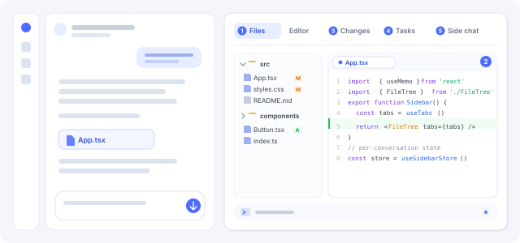
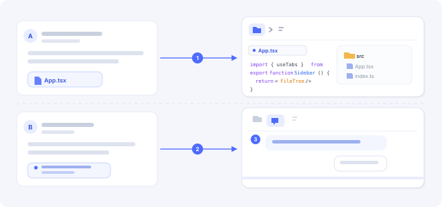

**One right sidebar, five tools, and a separate workspace for every conversation.**

1. **Files** — browse the conversation's workspace in a file tree, reveal folders, create, rename, move, delete, search and upload files.
2. **Editor** — open text, Markdown, HTML and code files in place; edit with syntax highlighting, save back to disk, and follow file links from chat straight to the line.
3. **Changes** — review the conversation's file changes by file or Git group, stage and unstage, inspect diffs, and commit without leaving the sidebar.
4. **Tasks** — follow subagent work as a workflow graph or tree, see the shared Agent Team task board, and open background-job output.
5. **Side chat** — ask a question beside the main conversation in a separate hidden thread, with its own model choice, queued messages and images.

The bottom workbench opens the host terminal under the same conversation, and the tab strip can be rearranged or hidden from Settings → Side card.

**Each conversation keeps its own state.** Open tabs, file tree expansion, editor drafts, changes selection, task view and side-chat threads belong to the conversation that opened them. Switching conversations switches the workbench back to that conversation's layout, and another conversation never overwrites it.
