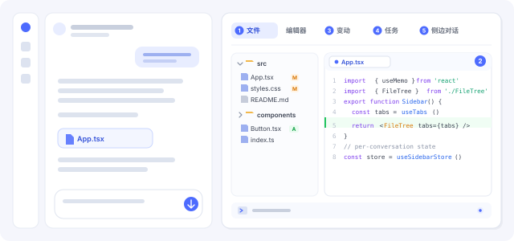
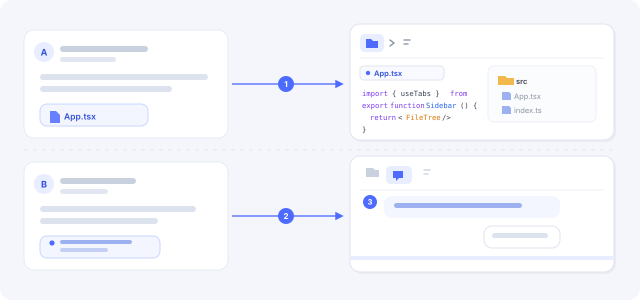

**一条右侧栏、五种工具，每个会话各自一套工作台。**

1. **文件** — 用文件树浏览当前会话的工作区：展开目录，新建、重命名、移动、删除、搜索与上传文件。
2. **编辑器** — 直接打开文本、Markdown、HTML 与代码文件；带语法高亮就地编辑并保存回磁盘，聊天里的文件链接可以定位到对应行。
3. **变动** — 按文件或 Git 分组查看本会话的改动，暂存 / 取消暂存、查看差异并提交，不用离开侧栏。
4. **任务** — 用工作流图或树查看子代理的工作，查看 Agent Team 共享任务板，并打开后台任务输出。
5. **侧边对话** — 在主对话旁边开一个隐藏的独立线程提问，有自己的模型选择、排队消息与图片输入。

底部工作台在同一会话下打开宿主终端；标签条可以在「设置 → 侧边卡片」里调整或隐藏。

**每个会话的状态互不干扰。** 打开的标签、文件树展开、编辑器草稿、变动选择、任务视图与侧边对话线程都归属于发起它们的会话。切换会话会切回该会话自己的工作台，另一个会话不会覆盖它。
