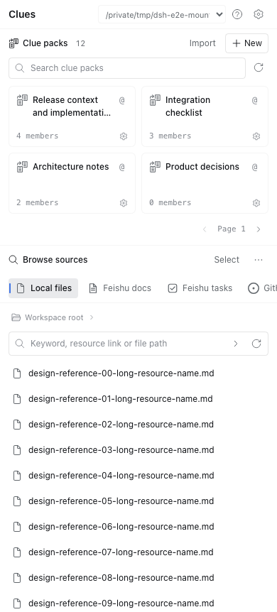
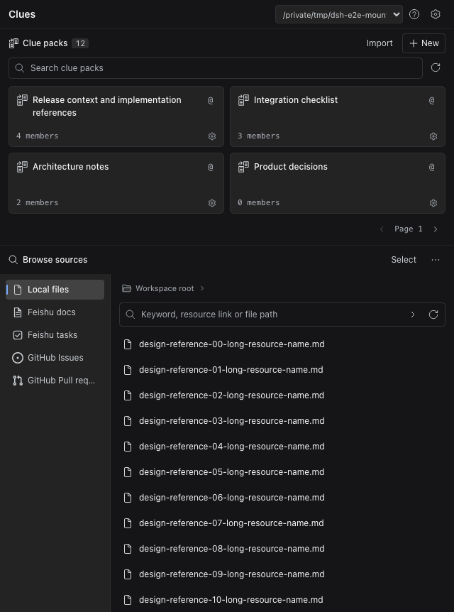
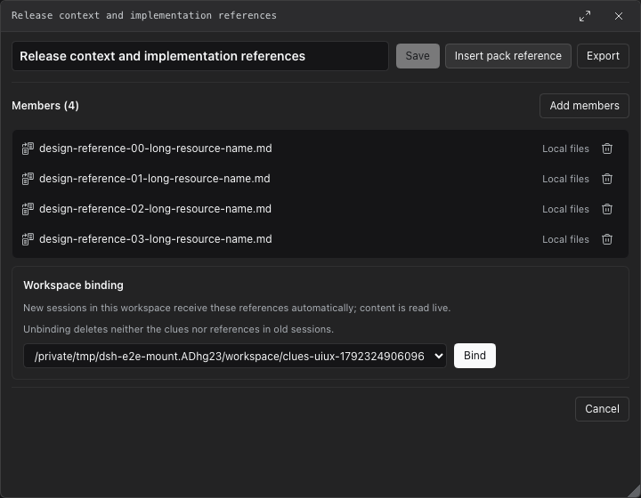
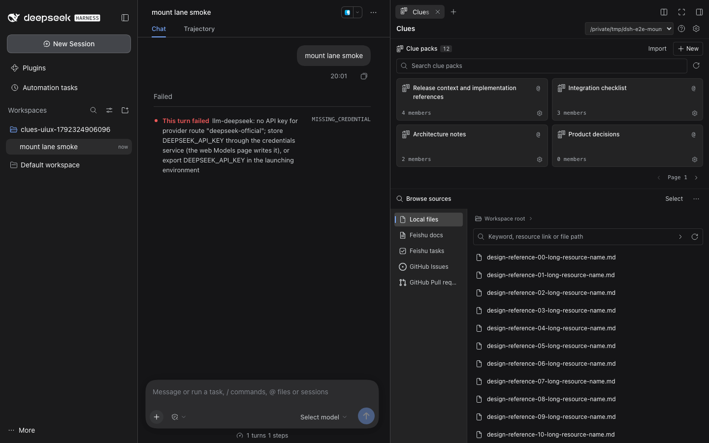

# 线索工作台第三轮：编辑器风格与 DSH Web 融合

日期：2026-10-18。用户要求继续美化，参照 VS Code／Codex／Zed GUI，同时融入 DSH 本体 Web 风格。实现保留在 `feat/clues-uiux-refresh` 工作区；[前两轮记录](2026-10-18-clues-uiux-refresh.md) 保留历史证据。用户随后要求取消高亮条并激进重构；当前工作台与新鲜证据见 [第四轮任务视图记录](2026-10-18-clues-task-flow.md)。

## 第三轮视觉规则（历史）

- **内容优先的资源卡**：移除点阵画布、整块 accent 染色及每张卡重复的“线索包”标签。采用中性 `bg-layer-1` 表面、`border-l1` 边缘、次要图标与两行名称；悬停／键盘聚焦时只增强边框或交互填充。保持主体插入引用、整条底栏管理的独立语义。
- **工具栏与搜索**：页头使用宿主 14px 字体，内容 chrome 沿用 12px、元信息 11px。新建保留轻描边，导入／多选等次操作采用安静的 ghost 样式，减少连续分隔线；所有颜色来自 DSH 令牌。
- **导航与列表**：窄栏来源为可滚动横条，520px 及以上为中性侧轨。选中态只使用宿主交互背景与细标记，结果行采用紧凑的 34px 节奏。触控目标继续扩大到至少 44px，键盘辅助操作与焦点路径保留。
- **窗口统一**：包管理／分享窗口正文采用宿主 12px 字体，成员和勾选列表对齐到紧凑行。清除页面根节点重复的 `10px 12px` 内边距，由共享浮窗 body 提供外侧留白；不修改公共浮窗的 CSS 或其他功能窗口。
- **表面层级**：普通卡片、绑定说明与来源配置使用中性 surface 阶梯；主操作保留宿主填充／前景／hover 的配对令牌。分享维持单一内容滚动区和固定操作栏，最小触控窗口保留整体滚动兜底。

本轮没有新增依赖、主题模式、数据请求、公共 API 或轮询。来源搜索、选择、置顶、草稿、分享和安装授权的既有行为继续由原模块处理。

## 验证结果

| 检查 | 本轮新鲜证据 |
| --- | --- |
| `pnpm typecheck` | 最终源码通过；完整宿主截图的样式清理回调已使用 Node 类型支持的标准 DOM 接口 |
| 定向 lint | 线索源码、本轮 e2e 与皮肤契约测试通过 |
| 定向回归 | 6 文件，153 tests passed：工作台、CSS、主题、包／分享浮窗、来源设置与配置 |
| `pnpm build && pnpm pack` | 通过；使用该产物挂载真实宿主 |
| 真实 DSH `0.2.1-rc.1` 定向挂载 | 2 passed，7.0s；使用独立 keyless scratch profile |
| 响应式与主题 | 320／390／640 Tab 容器宽度 × 明／暗主题；检查无横向溢出、导航按钮尺寸、标题两行和首屏来源结果 |
| 浮窗与帮助 | 帮助关闭恢复焦点、包管理入口、长分享预览滚动时操作栏稳定，以及 320×240／44px 触控操作可达 |
| 本体融合截图 | 完整页面截图前移除测试宽度覆盖，恢复原生侧栏几何，保留 DSH 导航、聊天与原生 Tab chrome |

挂载命令：

```sh
KEEP_HOME=1 npm_config_cache="$PWD/.npm-cache-tmp" \
NODE_OPTIONS=--max-old-space-size=4096 \
DSH_CMD='npx -y --package @deepseek-ai/dsh@0.2.1-rc.1 dsh' \
pnpm test:mount --grep clues
```

使用仓库忽略的 npm 缓存复用精确 RC 宿主，打包产物装入临时 profile。测试服务在脚本退出时清理，未向当前 GUI/profile 安装。未重跑全量单元测试或完整挂载 lane，不将前两轮的数字当成本轮全量结果。已有 source map、jsdom navigation 与 act 警告仍会输出。

## 最终截图

390px 浅色：



640px 深色：



包管理窗口：



[320px 浅色](assets/clues-editor-style/clues-light-320.png) · [分享操作区](assets/clues-editor-style/clues-share-fixed-actions.png) · [320×240 触控分享窗口](assets/clues-editor-style/clues-share-touch-320x240.png)

DSH 完整页面与原生栏：



完整页面来自无模型密钥的隔离宿主；聊天区的 `MISSING_CREDENTIAL` 是 keyless fixture 的真实状态，并非插件错误。截图未隐藏或伪造该状态。

## 边界与交付状态

- 本轮验证本地 fixture，不代表真实 GitHub／飞书账号、远程资源写入或真实 CLI 安装授权已验证。
- 工作区变更尚未提交、未合入 `dev`、未推送或发布，当前会话 GUI 不会因本次 scratch 挂载而自动更新。
- [接入指南 §12](../external-plugin-guide.md#12-皮肤兼容令牌驱动)、[S9 风格约定](../specs/10-17-线索收集-主设计/10-17-线索收集-S9-线索Tab与集成-设计.md#6-风格响应与稳态) 和 [CHANGELOG](../../CHANGELOG.md) 已同步当前方向。
