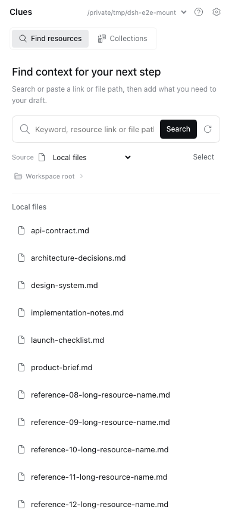
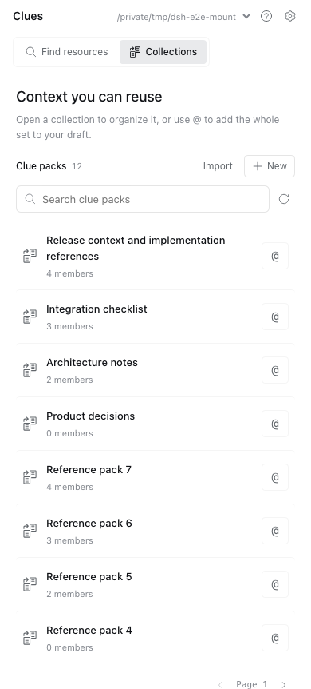
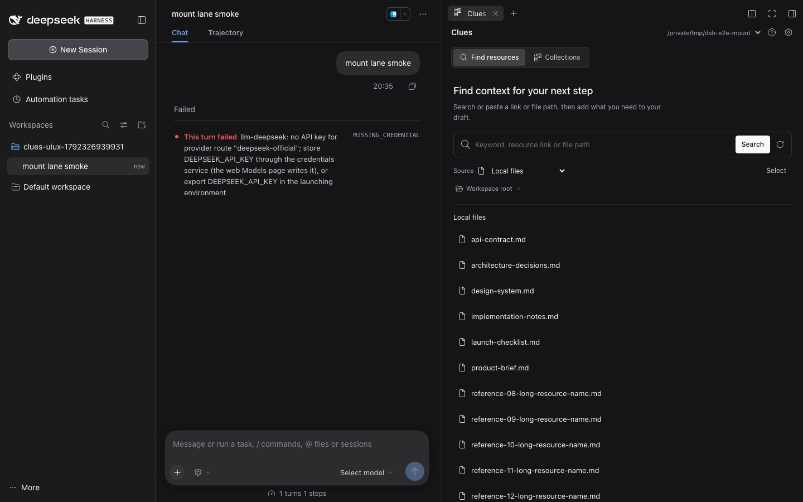

# 线索工作台第四轮：查找、整理与引用

2026-10-18。用户要求去掉高亮条，并授权更激进、面向未来且面向用户的 UI/UX 重构。本轮修改继续位于 `feat/clues-uiux-refresh`，取代旧的上下两区、卡片主体插入／底栏管理和首次强制教学。此前实现与证据保留在 [第三轮记录](2026-10-18-clues-editor-style.md)。用户于 2026-10-19 要求恢复融合上下分栏，当前实现与截图见 [第五轮记录](2026-10-19-clues-integrated-workbench.md)。

## 第四轮交互（历史）

1. **直接查找资料**。首次打开直接进入查找，不需要关闭教学。搜索框接受关键词、资源链接或文件路径；来源选择、多选与独立范围行放在附近，结果获得完整栏宽。`?` 仍可打开局部帮助。
2. **整理并复用线索包**。资料库作为独立任务视图，以完整列表替代卡片墙，每页 8 个包；名称最多两行，下方显示成员数。点标题管理，独立 @ 按钮插入整组引用，与单条资料“标题查看、@ 引用”的操作一致。
3. **按需切换，继续刚才的工作**。两个面板均保留挂载且分别滚动；查询、分页、选择、资料库筛选、新包名称和未保存范围不因切换丢失。方向键／Home／End 切换入口，隐藏控件不进入浏览器 Tab 顺序。

界面使用 DSH 的字体、文字与表面令牌；选中只靠中性填充与字重，没有高亮条、下划线、点阵或彩色卡片。13px 内容与 18px 任务标题建立层级，来源从长导航条／侧轨改成原生选择器；范围单独占行，避免在 320／390px 栏里被挤成省略号。

## 实现与行为保护

- [主页面](../../src/client/clues/tab/CluesTab.tsx) 只按工作区标识维护面板身份，不按模式重建；子视图的有效可见性为原生 Tab 可见且模式匹配。作者 CSS 明确使隐藏面板 `display: none`。
- [浏览器](../../src/client/clues/tab/browser.tsx) 以稳定来源 id／能力值驱动请求，来源目录反序列化成新对象不会重复拉页面；实际持久范围不变时，最近使用记录写入不会覆盖范围草稿。加入包选项在聚焦时刷新，保持已选资料。
- 输入法合成 Enter／兼容 keyCode 229 保留原生确认动作且不搜索；普通 Enter 阻止默认行为并仅提交一次。搜索区域采用明确的按钮与局部键盘处理，不引入隐式表单提交。
- [资料库](../../src/client/clues/tab/packs.tsx) 的标题与 @ 是并列按钮，互不触发。创建完成时若已离开该视图，不打开窗口或抢焦点；创建响应与列表刷新交错时按 id 更新同一包，避免重复记录。
- 隐藏视图停止自动读取；浏览／搜索／解析在飞请求真正收到 AbortSignal。包、置顶和本地库 API 不支持传输级取消，自动读取只忽略过期响应，不宣称网络请求全部取消。用户已经发起的修改允许完成。
- [帮助](../../src/client/clues/tab/help.tsx) 随需打开，只使本 Tab 被覆盖内容 inert，聊天仍可操作；关闭恢复触发按钮焦点。保留详情、编辑、安装授权、分享及稳定引用协议。
- 7 个新 UI 键同步全部词典；zh／en／ja 提供对应文案，其余 18 份沿用英文占位。

## 本轮最终验证

| 检查 | 新鲜结果 |
| --- | --- |
| 类型与 lint | 最终源码 `pnpm typecheck`、线索 Tab／共享词典／本轮测试的定向 eslint 通过 |
| 回归 | 10 文件、191 tests passed（20:35:23）；工作台、浮窗、设置、主题、词典与 steady-state |
| 构建打包 | `pnpm build && pnpm pack` 通过；真实挂载使用同次产物 |
| 真实宿主 | 精确 DSH `0.2.1-rc.1`，独立 keyless scratch profile；2 passed（8.0s） |
| 响应式／主题 | 两个视图分别在 320／390／640px × 明暗主题检查，无横向溢出，长包名最多两行，查找结果进入首屏 |
| 键盘／状态 | 实际浏览器验证方向键、Home、隐藏面板跳过 Tab 顺序、查询跨模式保留、帮助关闭恢复焦点 |
| 分享 | 长预览滚动时底部操作位置稳定；320×240 粗指针窗口所有主操作可滚动到达且高度至少 44px |

定向回归保留原有范围持久化、直接 URL 识别、失败重试、置顶及来源开关检查；新增／加强覆盖默认模式不加载资料库、跨模式中止与晚到结果、目录新对象只刷新一次、未保存范围与多选保留、标题／@ 分离、后台创建不抢焦点及竞态去重。IME 是合成事件回归，未将其描述为真实 OS 输入法端到端验证。

同次挂载命令：

```sh
KEEP_HOME=1 npm_config_cache="$PWD/.npm-cache-tmp" \
NODE_OPTIONS=--max-old-space-size=4096 \
DSH_CMD='npx -y --package @deepseek-ai/dsh@0.2.1-rc.1 dsh' \
pnpm test:mount --grep clues
```

最终检查仍有既有的 source-map／jsdom navigation／部分 React act 警告；本轮创建竞态用例的重复 key 警告已消除。未重跑全量单元测试或完整挂载 lane，不借用前三轮的全量数字。

## 实际截图

| 查找资料 · 390px 浅色 | 线索包 · 390px 浅色 |
| --- | --- |
|  |  |

[320px 查找](assets/clues-task-flow/clues-find-light-320.png) · [640px 深色查找](assets/clues-task-flow/clues-find-dark-640.png) · [640px 深色资料库](assets/clues-task-flow/clues-collections-dark-640.png) · [包管理](assets/clues-task-flow/clues-pack-management.png) · [分享操作区](assets/clues-task-flow/clues-share-fixed-actions.png) · [最小触控窗口](assets/clues-task-flow/clues-share-touch-320x240.png)



完整页面截图前恢复原生侧栏几何。聊天区 `MISSING_CREDENTIAL` 是隔离 keyless 宿主的真实状态，未隐藏或伪造；它不代表插件错误。

## 交付边界

源代码、设计修订和截图已写入当前功能分支工作区，尚未提交／合入 `dev`／推送／发布，也未安装到用户当前 GUI/profile。DSH 源码未修改，测试服务由挂载脚本清理。

本轮为本地 fixture 和真实目标宿主验证；真实 GitHub／飞书账号、远程写入、真实 CLI 安装和授权未验证。[S9](../specs/10-17-线索收集-主设计/10-17-线索收集-S9-线索Tab与集成-设计.md)、[主设计](../specs/10-17-线索收集-主设计/10-17-线索收集-主设计.md)、[皮肤指南](../external-plugin-guide.md#12-皮肤兼容令牌驱动) 与 [CHANGELOG](../../CHANGELOG.md) 已同步最新交互。
