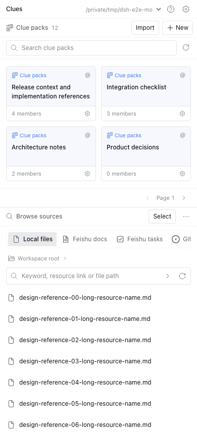
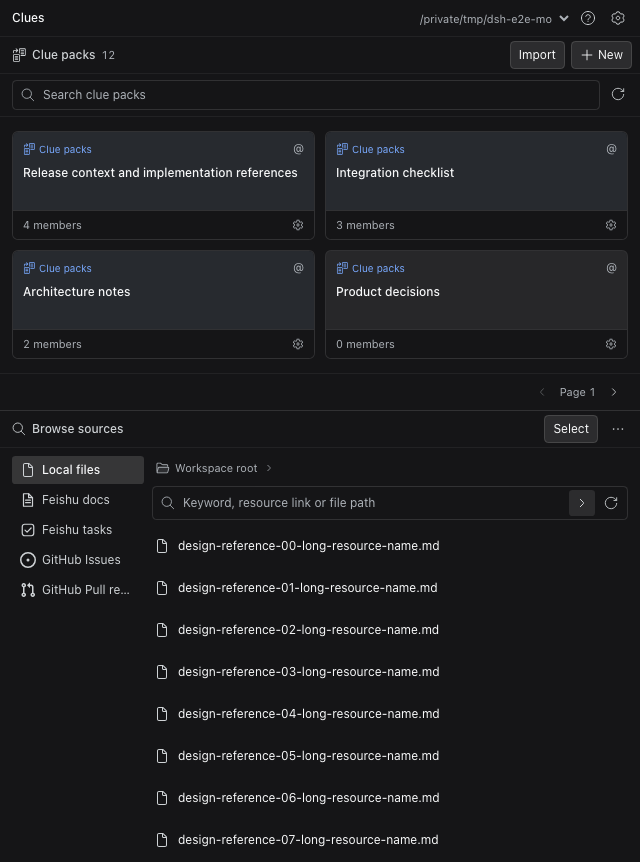
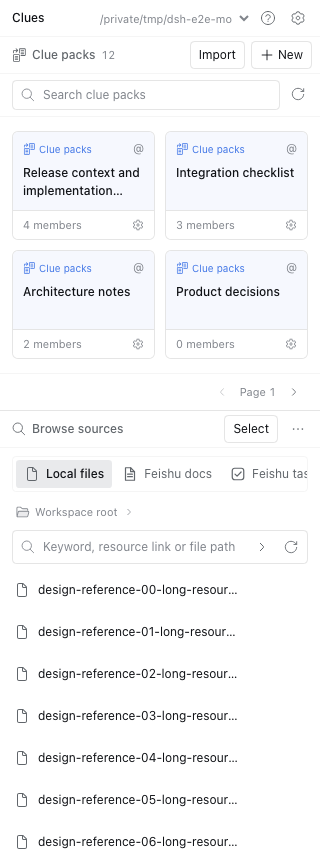
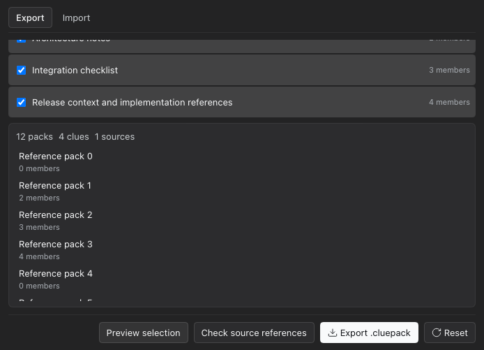

# 线索收集 UI/UX 重构与验证记录

日期：2026-10-18。实现位于 `feat/clues-uiux-refresh`，范围以 [线索收集主设计](../specs/10-17-线索收集-主设计/10-17-线索收集-主设计.md) 的 S1–S9 为依据。用户指出首轮视觉过于碎片化，明确要求参照任务管理页；本文保留第二轮设计与当时证据。后续编辑器风格及当前截图见 [第三轮记录](2026-10-18-clues-editor-style.md)。未发布、未安装到用户当前 profile，未修改 DSH 源码。

## 当前设计

参照仓库任务管理页的 36px 页头、12px 强标题／11px 元信息、对齐的工具栏，以及卡片身份区与底栏的分工。保持上下两个独立区域，不将线索包变成任务树。

- 页头收为一行，工作区作为次要上下文，帮助与设置为紧凑图标按钮。移除常驻副标题和操作教学段落，说明保留在帮助、无障碍名称与控件提示中。
- 包库为轻点阵画布，卡片身份区使用宿主 business accent 的 5% 混色，底栏保持中性。包名称最多两行，主体显示 `@` 并插入引用；整个成员底栏是独立的管理按钮。
- 每页显示 4 个包，默认两列两行，避免包库占满首屏。分页缩为箭头与页码。回归用实际成员数、空包和长名称检查布局。
- 来源入口组成一组导航；窄栏横排、宽栏左排，按容器宽度响应。范围摘要本身可点击编辑，名称包括动作与当前范围。搜索、解析与刷新合并在一条输入工具栏。
- 无置顶时隐藏空区；置顶失败仍显示独立反馈，重试期间保留按钮与焦点、阻止重复提交。成功后仅在用户仍聚焦重试按钮时回到查询框，不抢走已移往其他区域的焦点。
- 结果列表使用任务页的文字节奏；当副标题与标题相同，省略重复一行。标题打开详情，独立 `@` 插入草稿；辅助操作仍支持键盘与触控。

## 保留的行为修复与关联界面

- 切换 Tab 保留来源、查询与新包草稿；隐藏时取消在飞浏览；来源开关即时生效，IME 合成 Enter 不提前搜索。
- 帮助作为 Tab 内非模态页面，覆盖内容进入 inert 状态；聊天仍可操作，Escape 只在帮助内部处理，关闭后恢复触发按钮焦点。
- 来源设置复用宿主 Button；包管理、详情、GitHub／飞书编辑与分享统一主题、键盘焦点和触控尺寸，未改变安装、授权、服务路由或引用协议。
- 分享主操作在预览滚动区外；正常窗口固定操作栏，最小触控窗口允许整体滚动。预览期间锁定模式与包选择；新开窗请求改变输入时取消旧预览，纯重新聚焦不打断任务。
- 中／英／日文案明确引用、原资源、快照、成员移除与授权。新增键同步所有词典；其余 18 份语言沿用英文占位。

## 验证证据与时间边界

| 检查 | 结果与适用范围 |
| --- | --- |
| 第二轮类型检查／定向 lint | 最终源码（含焦点修复）通过；同次执行定向回归、构建、打包与挂载，命令整体退出码为 0 |
| 第二轮定向回归 | 工作台、包／分享浮窗、CSS、主题共 4 文件，89 tests passed；包含置顶延迟重试的焦点回归 |
| 第二轮构建与打包 | `pnpm build && pnpm pack` 通过，产物用于新的真实挂载 |
| 第二轮真实宿主挂载 | 线索定向检查 2 passed；320／390／640 明暗主题、导航尺寸、两行标题、首屏来源结果、帮助焦点、管理入口、分享滚动与最小触控窗口 |
| 首轮全量单元测试 | 278 文件通过，3906 passed / 18 skipped；第二轮未重新运行全量单元测试，不将此数字作为第二轮全量结果 |
| 首轮完整宿主挂载 | 精确 DSH `0.2.1-rc.1`，全新 keyless scratch profile：15 passed / 3 skipped；该结果早于任务页风格重做，第二轮采用上述定向挂载 |
| 消费者类型与引擎门禁 | 首轮 `pnpm check:consumer-types && pnpm check:engines` 通过；第二轮未改公共 API／依赖／引擎声明 |

第二轮挂载命令：

```sh
KEEP_HOME=1 npm_config_cache="$PWD/.npm-cache-tmp" \
NODE_OPTIONS=--max-old-space-size=4096 \
DSH_CMD='npx -y --package @deepseek-ai/dsh@0.2.1-rc.1 dsh' \
pnpm test:mount --grep clues
```

测试通过 npx 使用精确 RC 宿主，缓存位于仓库忽略目录，插件安装到临时 scratch profile。没有修改用户全局 npm 缓存所有权或当前 profile。宿主包 source map 缺失、jsdom navigation 和既有异步 act 警告仍会输出；通过不代表零警告。

## 第二轮真实宿主截图

390px 浅色工作台：



640px 深色工作台：



320px 浅色工作台：



长分享预览，操作区保持在滚动面板外：



首轮截图保留用于对照：[320px 首轮](assets/clues-uiux-refresh/clues-light-320.png)、[640px 首轮](assets/clues-uiux-refresh/clues-dark-640.png)。

## 验证边界与交付状态

- 来源自动化使用隔离本地资源与假 CLI。真实 GitHub／飞书账号、远程资源读写及真实 `lark-cli` 安装／授权未验证。
- 当前会话 GUI 此前检查未挂载本插件。scratch 挂载通过不能说明当前 GUI 已更新；本次没有向其 profile 安装插件或启动替代服务。
- 结果保留在功能分支工作区供审阅，未提交、未合入共享 `dev`、未推送或发布。
