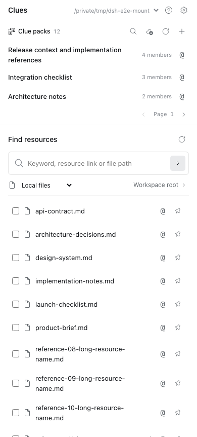
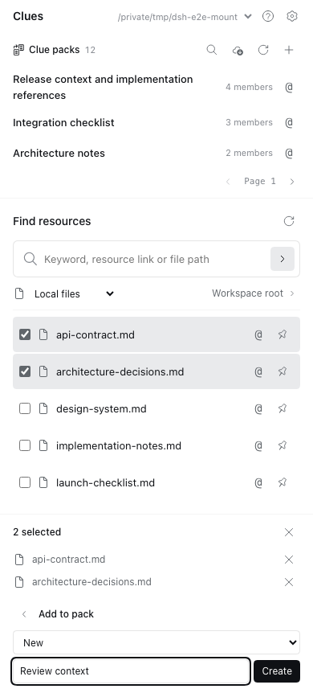

# 线索工作台第六轮：直接选择与明确收集

> 历史记录：来源／类型与收集目标的下拉式交互已由[第七轮可见导航](2026-10-19-clues-visible-navigation.md)取代。下列截图与测试数字只属于第六轮。

2026-10-19。用户仍认为 UI/UX 不合理，要求更大胆、人类友好且现代的设计。本轮保留上小下大的融合布局与无高亮条要求，重新安排核心操作，不再用一轮间距调整代替交互设计。

## 问题与改动

- 原先包搜索和资源搜索同时常驻，上区只显示两个截断名称的卡片。本轮改为三条全宽包列表，包搜索按需展开，过滤条件在收起后保留；标题管理、独立 @ 插入草稿。
- 原先需要先开启多选，再选择资料。本轮直接提供复选框，引用和置顶也常驻可见，不依赖悬停发现动作。
- 原先切换下拉选项就写入目标包。本轮先检查底部清单，再选择用途；进入收集表单后只展示目标选择与明确提交。可用所选资料直接创建新包，无需离开浏览区先建立空包。
- 选择跨来源／翻页保留，清单带来源图标、名称与逐项移除。成功项从清单移走，失败项保留，可重试剩余工作；写入后的包区刷新不重置查询或选择。
- 刷新重载当前查询与游标；清空搜索是单独动作。来源与范围在同一响应式上下文行中，范围操作提高文字对比和字号。
- 收集表单打开时焦点进入目标选择器，返回时回到触发按钮。主操作只在实际提交位置突出；选择清单为全宽底部区域，不嵌套卡片。

## 实现边界

主要实现：[容器](../../src/client/clues/tab/CluesTab.tsx)、[包列表](../../src/client/clues/tab/packs.tsx)、[资源浏览器](../../src/client/clues/tab/browser.tsx)、[样式](../../src/client/clues/tab/clues-tab.module.css)。复用既有 API、宿主图标和主题令牌，没有新依赖、轮询或 DSH 源码改动。新建包先确保本地稳定引用，再一次提交成员集合；不创建或改写远端资源。多成员加入既有包沿用顺序 CAS，不宣称跨请求事务原子性。

隐藏原生 Tab 保留本地草稿并停止自动读取；列表／搜索／解析继续使用 AbortSignal。包和本地库等不支持传输取消的调用保留晚到结果忽略机制，不宣称所有网络请求都可中止。

## 验证

- `pnpm typecheck`、本轮 TSX／测试的定向 ESLint、`pnpm build && pnpm pack` 已通过。
- 10 个文件共 **201 项相关回归通过**：工作台 36 项（含 7 项新增流程回归），其余 9 文件 165 项（主题、CSS、包／分享窗口、设置、本地化、隐藏稳态）。分别运行，不冒称完整仓库测试。
- 新增流程覆盖显式确认、新建包的准确成员、跨来源清单移除、部分失败后的剩余项目重试、创建草稿隐藏后恢复、刷新保留查询／游标及打开／返回焦点。
- 最终精确 **DSH 0.2.1-rc.1** 隔离 profile 挂载 **2 passed（8.9s）**。覆盖 320／390／640px 栏宽 × 明暗主题，默认与收集两种状态，390×844 手机视口，包区占比、结果独立滚动、无横向溢出、标题／@ 键盘路径、清除与刷新、表单打开／返回焦点。
- 真实 API 验证了新包提交前不存在、点击确认后出现且准确包含所选两项；包区立即更新。另保留长分享预览和 320×240 触控分享窗口检查。第一轮之后的最终截图已重新生成，没有沿用旧产物。

复验命令：

```sh
KEEP_HOME=1 npm_config_cache="$PWD/.npm-cache-tmp" \
NODE_OPTIONS=--max-old-space-size=4096 \
DSH_CMD='npx -y --package @deepseek-ai/dsh@0.2.1-rc.1 dsh' \
pnpm test:mount --grep clues
```

## 最终截图

| 默认浏览 | 选择后创建包 |
| --- | --- |
|  |  |

[深色宽栏](assets/clues-direct-collection/clues-integrated-dark-640.png) · [手机视口](assets/clues-direct-collection/clues-selection-mobile.png) · [完整 DSH 宿主](assets/clues-direct-collection/clues-integrated-shell-dark.png) · [触控分享](assets/clues-direct-collection/clues-share-touch-320x240.png)

截图来自真实本地 fixture；完整宿主中的 `MISSING_CREDENTIAL` 是 keyless 测试会话状态，不是插件错误。

本轮检查曾发现旧 CSS 测试仍要求悬停后显示按钮，现改为常驻可见及复选框焦点断言；新增测试夹具的只读成员／revision 修改已改为不可变对象替换，类型检查复验通过。既有宿主缺失 source-map、jsdom navigation 和分享测试 act 警告仍存在，没有将它们描述为已修复。

## 交付边界

仍在 `feat/clues-uiux-refresh`，未提交、合入共享分支、发布或安装到当前 GUI。测试使用隔离 profile 和本地 fixture；真实 GitHub／飞书账号、远端写入和 CLI 授权未验证。没有启动替代当前 GUI 的服务器。
