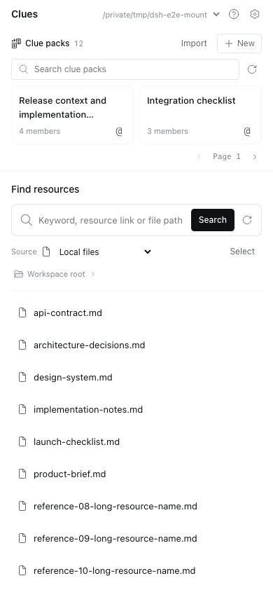
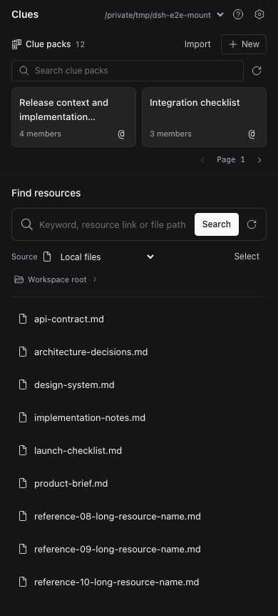
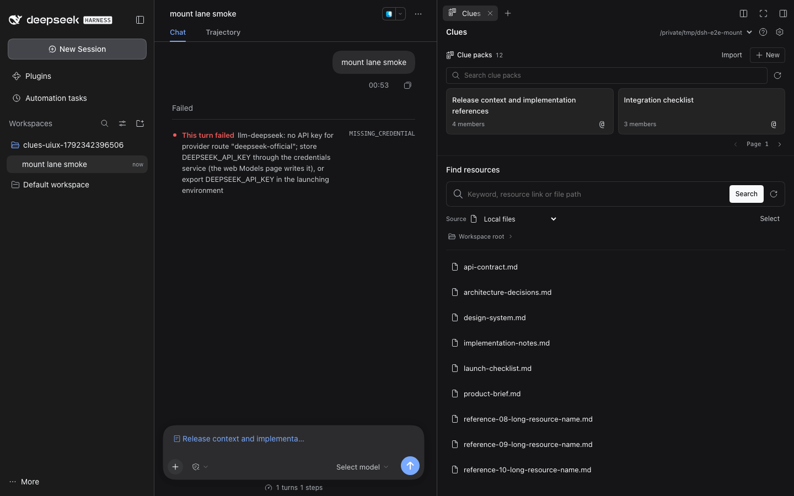

# 线索工作台第五轮：上小下大的融合布局

> 历史记录：本轮之后用户继续要求改进 UX。现行设计与新鲜证据见[第六轮直接收集](2026-10-19-clues-direct-collection.md)，下列截图和数字只属于第五轮。

2026-10-19。用户明确希望重新融合为上下分栏，上方更小，并继续大胆设计现代、人类友好的样式。本轮取代[第四轮双视图](2026-10-18-clues-task-flow.md)，保留此前“不使用高亮条”的约束。实现仍位于 `feat/clues-uiux-refresh` 工作区。

## 当前设计

- **小包架**：上方一排 2 个包，保留包搜索、翻页、新建和导入；名称最多两行、成员数为次级信息，独立 @ 始终可见。移除独立资料库的大标题、说明段落和模式切换。默认高度约为整个 Tab 的四分之一，最大为 `min(38%, 260px)`，创建或错误状态超出时在上区内部滚动。
- **主要查找区**：下方占剩余空间，区标题 14px，搜索入口比包搜索更醒目；来源和范围在附近，不重复显示来源标题。资料结果内部滚动，搜索、来源、范围和批量操作保持可达；低矮窗口保留整区滚动兜底。
- **一致的动作**：标题查看／管理，@ 插入草稿，均不发送。包的筛选、翻页与引用不影响下方查询、分页、多选或未保存范围；隐藏原生 Tab 再显示仍保留两区状态。
- **DSH 视觉**：使用宿主中性表面、字体、边框和配对主按钮令牌；包卡片无装饰染色、阴影或高亮条。卡片和控件的键盘焦点保持可见，粗指针目标至少 44px；帮助继续随需打开。

主要实现位于[主页面](../../src/client/clues/tab/CluesTab.tsx)、[包架](../../src/client/clues/tab/packs.tsx)、[浏览器](../../src/client/clues/tab/browser.tsx)及[工作台样式](../../src/client/clues/tab/clues-tab.module.css)。两区按同一工作区标识保留挂载，不新增尺寸观察器、周期读取或第三方依赖。

## 交互与请求保护

本轮发现原先独立的“来源重置 effect”和“页面加载 effect”会在首个来源解析后重复读取，也可能在切换时先向新来源发送旧关键词／游标。现由一个加载生命周期处理来源切换：首次解析不再重置初始列表状态，实际换来源时先重置查询与游标再请求；仍保留跨来源已选资料。

[29 项工作台组件回归](../../tests/clues-tab-main.spec.tsx)验证了初次每区各读一次、原生 Tab 再显示各补刷一次、晚到结果忽略、来源切换不携带旧请求参数、引用更新不重置范围草稿，以及两区搜索和包翻页互不影响。后台创建完成不抢焦点／开窗，刷新与创建响应交错时按 id 更新同一包。输入法合成 Enter 保留默认确认动作，不误搜索；置顶重试保持按钮和焦点。

## 本轮新鲜验证

| 检查 | 结果 |
| --- | --- |
| 类型／定向 lint | 最终源码通过 `pnpm typecheck` 与线索 Tab、词典及本轮测试的 eslint |
| 定向回归 | 10 文件、192 tests passed（00:50:58），覆盖工作台、CSS、主题、窗口、设置、词典及 steady-state |
| 构建与打包 | 最终 `pnpm build && pnpm pack` 通过，产物用于隔离宿主 |
| 真实目标宿主 | 精确 DSH `0.2.1-rc.1`、keyless scratch profile，最终 2 passed（7.8s） |
| 布局 | 320／390／640px × 明暗主题，两区同时可见、上区默认小于总高 35% 且小于下区、首屏有真实结果、无横向溢出、长包名两行 |
| 滚动／键盘 | 每档宽度验证结果内部滚动时搜索框与包区位置不变；实际 End 键到达列表底部；标题 Tab 到独立 @ 可插入且不打开管理窗 |
| 保留状态 | 实际宿主验证包筛选后浏览查询仍保留，@ 引用只进入草稿；原生隐藏／恢复和跨来源选择由组件回归覆盖 |
| 分享 | 长预览滚动时操作栏位置稳定；320×240 触控浮窗的主操作均可滚动到达且至少 44px |

初次挂载在刷新后的完整列表到达前按 End，使键盘检查失败；用例现明确等待 25 条列表和可滚动状态，再验证 End 到达底部，未通过扩大超时掩盖同步问题。最终完整页面截图等待原生滚动结束再复位，并恢复宿主原生栏宽。

[皮肤测试](../../tests/theme.spec.ts)继续检查零硬编码颜色、配对主按钮令牌及无伪元素高亮条，并加强包卡片中性表面的约束。既有 source-map、jsdom navigation 和部分 React act 警告仍输出。未重跑全量单元测试或完整挂载 lane，前四轮数字未作为本轮全量结果。

真实挂载命令：

```sh
KEEP_HOME=1 npm_config_cache="$PWD/.npm-cache-tmp" \
NODE_OPTIONS=--max-old-space-size=4096 \
DSH_CMD='npx -y --package @deepseek-ai/dsh@0.2.1-rc.1 dsh' \
pnpm test:mount --grep clues
```

## 最终截图

| 390px 浅色 | 390px 深色 |
| --- | --- |
|  |  |

[320px 窄栏](assets/clues-integrated-workbench/clues-integrated-light-320.png) · [640px 深色宽栏](assets/clues-integrated-workbench/clues-integrated-dark-640.png) · [包管理](assets/clues-integrated-workbench/clues-pack-management.png) · [分享操作栏](assets/clues-integrated-workbench/clues-share-fixed-actions.png) · [最小触控分享窗口](assets/clues-integrated-workbench/clues-share-touch-320x240.png)



完整页面中已能看到 @ 插入草稿的包引用。聊天区的 `MISSING_CREDENTIAL` 是隔离 keyless 宿主的真实状态，不是插件错误，未隐藏或伪造。

## 边界

变更尚未提交、合入 `dev`、推送或发布，未安装到当前 GUI/profile。DSH 源码未改，测试服务由挂载脚本退出清理。本轮验证本地 fixture 与真实目标宿主，真实 GitHub／飞书账号、远程写入及 CLI 安装授权未验证。

[S9 修订](../specs/10-17-线索收集-主设计/10-17-线索收集-S9-线索Tab与集成-设计.md)、[主设计](../specs/10-17-线索收集-主设计/10-17-线索收集-主设计.md)、[皮肤指南](../external-plugin-guide.md#12-皮肤兼容令牌驱动)和[变更记录](../../CHANGELOG.md)已同步融合布局；帮助文案同步 zh／en／ja，其余词典继续沿用英文占位。
