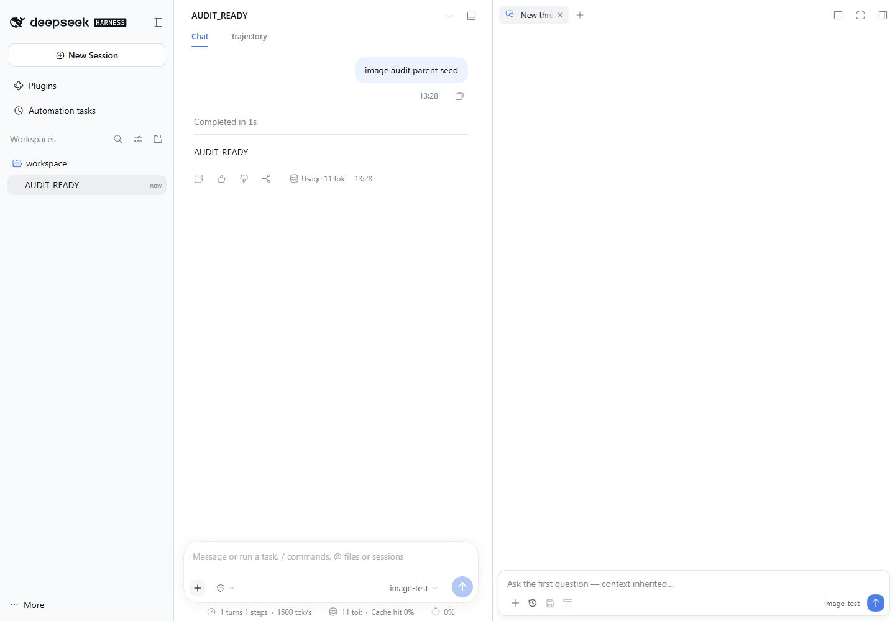
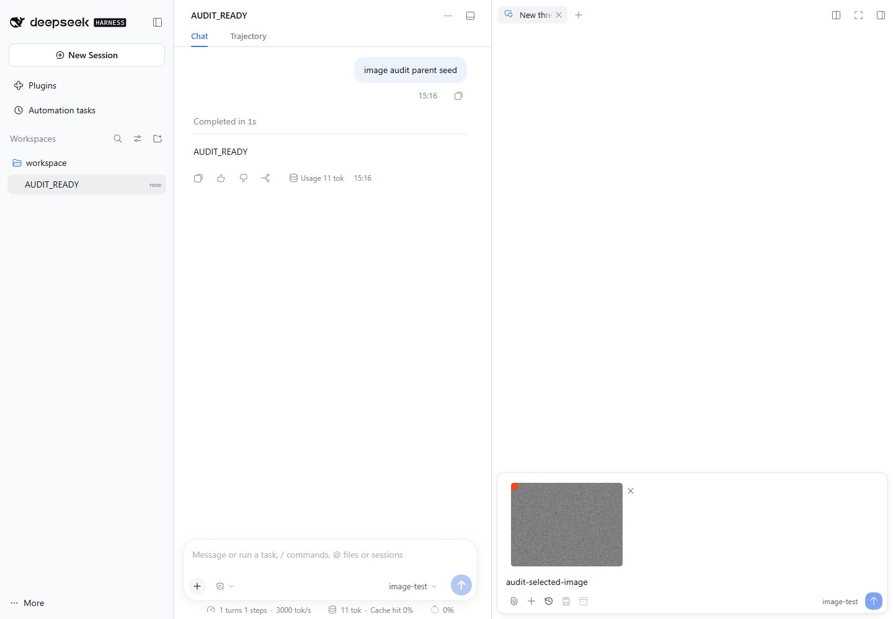
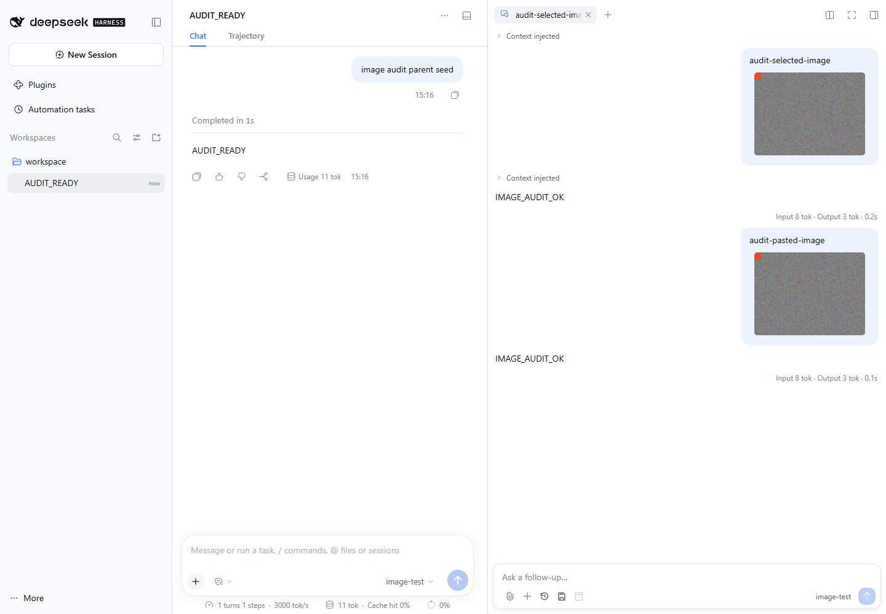

# Side Chat image input

Side Chat accepts PNG, JPEG, WebP and GIF through the file picker or clipboard. The composer reuses the host's 16px paperclip icon as its attachment entry. A draft owns its files and preview URLs until the user removes them, the thread binding ends, or the host accepts that part of the draft. Image-only prompts are valid. Limits are the smaller of the host attachment limits and 8 images, 10 MiB per image, 20 MiB total.

The browser sends text and encoded images together in `sidechat.prompt`. The host validates the entire batch, checks the thread's effective model, and admits all image bytes through `attachments.admitPromptContent` before adding the first-contact boundary or user message. The host creates the user message ID. Accepted echoes, pending rows and durable rows reconcile by that ID; identical text does not establish identity. The accepted echo shows image processing until the pending or durable projection exposes the occurrence. The host may await system-prompt assembly after claiming an inbox message and before logging it, so an echo alone does not establish read membership.

The ordinary JSON body limit stays 1 MiB. Only the exact prompt method gets enough additional room for bounded base64, with a separate 1 MiB metadata limit and at most two concurrent prompt body/admission requests. Oversized streams return 413. Authentication runs before buffering. The attachment service validates actual image content. Its durable writes and the Agent inbox are separate host operations: storage failure can leave unreferenced image bytes, and process failure between boundary injection and followup cannot be made transactional in a plugin.

The image GET locator is `{childId,messageId,blockIndex}`. A supplied attachment ID or filesystem path is never read authority. The route verifies a sidechat creation descriptor, subagent origin and parent, then finds the occurrence in the thread's own durable user messages or current legitimate pending inbox. It excludes inherited ghosts and messages removed before claim. Responses use the host media type, `nosniff`, and `private, no-store`. Cold reads do not activate an Agent. Transcript, metadata and image requests share a bounded per-persistence snapshot cache keyed by the host storage revision, including concurrent-read deduplication.

Cold pending replay folds every inbox splice over full messages before excluding exact inherited IDs. Filtering the inherited prefix before replay would change queue indices. Cold rows expose previews but cannot dequeue through the existing live-only API.

Each draft binding has its own active lifetime and revision. FileReader and request completion retain their captured child ID, so A-to-B-to-A navigation cannot deliver to a new owner or erase its draft. An accepted attempt retires only its captured image IDs; newer edits remain. Object URLs are revoked on removal and teardown. Saved previews load through the authenticated host route only while visible and release their blob URLs when hidden. A lost network response preserves the draft and tells the user to check the conversation before retrying. There is no automatic replay.

Cold resumes are shared per thread. Closing a thread or unloading the plugin invalidates pending delivery and cancels an unfinished resume. After asynchronous admission, delivery rechecks the current model and lifetime, compares the validated selection again without an intervening await, then synchronously decides whether to add the first boundary and enqueue the message. If followup throws immediately, only that newly inserted boundary is removed.

The selected design uses host-created IDs and one combined prompt request. A staged upload registry would add lease/receipt cleanup without a host transaction. A client-created frozen message would rely on additional inbox-consumer compatibility. Independent review selected the combined host-ID design and added explicit lifecycle guards and resource limits.

Verification covers batch failure before boundary, effective model changes, plugin unload, message identity, image-only input, occurrence ownership, cold full-log replay, shared cold reads, clipboard/picker input, delayed completions, draft URL cleanup, localized uncertainty, and theme constraints. A separate real-host harness captures the OpenAI-compatible provider request and decodes its image payload, then checks page reload and cold restart previews. Actual run results belong in the PR verification evidence.

The reusable harness runs against preinstalled host dependencies. Create an isolated directory with a minimal package manifest, install `@deepseek-ai/dsh@0.2.1-rc.1` there using the registry and memory options from AGENTS, then build this repository and install Playwright Chromium. No provider key is required; the harness starts a deterministic loopback provider and a separate scratch profile.

```sh
node scripts/e2e-sidechat-images.mjs --host-root /path/to/isolated-host --large-image --mount-check
```

Use `--channel chrome` for an installed Chrome, `--plugin /path/to/unpacked/package` to exercise a tarball, `--baseline` for the unchanged plugin, and `--artifacts-dir /path/to/results` to retain evidence at a chosen location. The default is a fresh directory in the system temp area. The script stops only its own host process tree and retains the fixture, screenshots and provider captures.

The recorded rc.1/Chrome run selected and pasted a 1024×768 PNG of 2,352,559 bytes. The JSON prompt bodies were 3,136,904 and 3,142,724 bytes, both above the old 1 MiB cap. The model-request images were normalized JPEGs; decoded dimensions and fixture pixels matched. Eight image reads across delivery, page reload and a complete host restart returned 200. The same run opened the Files editor and replaced the client entry inside the page without a registration error. See the [verification receipt](sidechat-image-input/verification.json).

| Before image input | Draft preview | After a cold host restart |
| --- | --- | --- |
|  |  |  |
